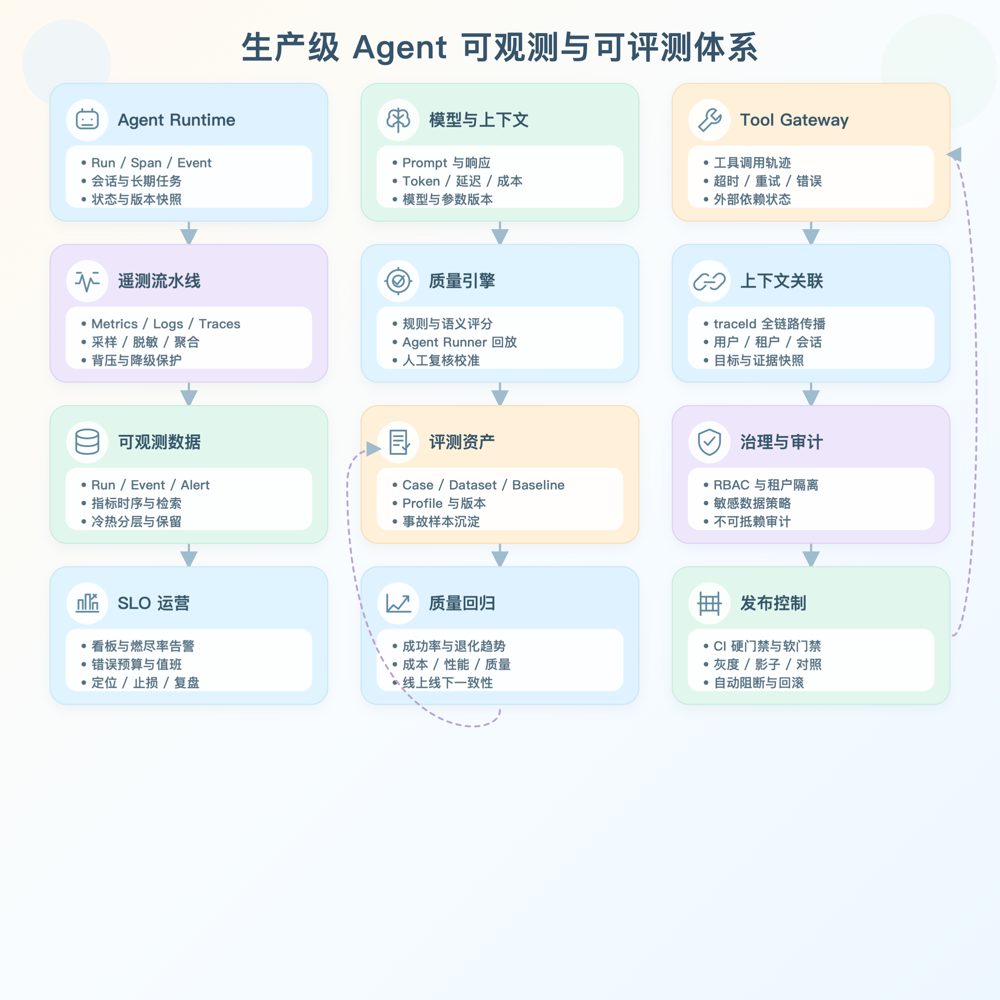

# 第六节｜构建生产级 Agent 可观测与可评测系统

> 本节不再只做一个可以演示的页面，而是围绕 Agent 上线后的两个核心问题展开：系统发生问题时能否解释，版本发生变化时能否证明质量没有退化。
>
> 本节基于前五节已经完成的 Agent、会话、Skill、Tool、审批、用户隔离和 MySQL 持久化继续开发。完成后，项目将拥有从真实运行采集、问题定位，到离线回归、基线对比、发布门禁和人工复核的完整闭环。

---

# 第一部分：理解可观测性、可评测性与企业级技术方案

## 1. 为什么 Agent 比普通应用更需要观测和评测

传统 Web 系统的大多数行为由确定性代码驱动。同样的输入通常进入相同分支，失败可以通过异常堆栈、状态码和数据库记录定位。

Agent 系统不同。一次回答由模型、Prompt、历史上下文、Tool、Skill、知识库、运行时策略和外部服务共同决定。即使输入相同，模型输出和工具轨迹也可能不同。因此，“接口返回 200”只能证明请求结束，不能证明任务完成得正确。

生产 Agent 必须持续回答两组问题。

运行时问题：

- 这次请求使用了哪个 Agent、模型、Prompt、Skill 和 Tool？
- 首 Token、总耗时、Token 和成本是多少？
- 调用了哪些 Tool，参数和结果是什么，在哪一步失败？
- 模型是否自动重试？用户取消后是否仍有悬空调用？
- 故障来自模型、Tool、策略、存储还是业务逻辑？

质量问题：

- 新模型或新 Prompt 是否比基线更好？
- 一个任务“完成”应该由哪些断言定义？
- Tool 轨迹、结构化输出和安全策略是否仍然正确？
- 哪些失败必须阻断发布，哪些需要人工判断？
- 历史报告能否说明当时测试的是哪个版本？

前一组由可观测系统回答，后一组由评测系统回答。两者缺一不可。

## 2. 什么是 Agent 可观测性

可观测性不是“多打印日志”，而是根据系统产生的外部信号，推断一次 Agent 运行内部发生了什么。

### 2.1 三层观测对象

本项目采用 Run、Event、Alert 三层模型。

**Run：一次完整任务**

Run 对应一次用户消息驱动的 Agent 执行，记录 traceId、用户、会话、Agent、模型、目标快照、脱敏后的输入输出、状态、Token、成本、TTFT、吞吐、重试次数、总耗时和 Tool 调用数。

**Event：运行内部时间线**

Event 记录 `run_start`、`skill_trace`、`tool_start`、`tool_end`、`retry`、`run_end`、`error` 和 `recovery`。Tool 通过 `toolCallId` 关联开始和结束，从而计算耗时、失败率并识别悬空调用。

**Alert：需要处理的异常**

Alert 来自运行失败、取消、超时、耗时超限、成本超限、悬空 Tool 和异常退出遗留 Run。告警具有 active 和 acknowledged 状态，避免“看到问题但无法闭环”。

### 2.2 Agent 关键指标

Agent 指标不能只看“请求是否成功”，还要同时覆盖可用性、用户体验、模型消耗、工具链和最终任务质量。建议统一以 Run 为统计单位，并按 Agent、模型、数据集版本和时间窗口进行分组。

| 维度 | 核心指标 | 计算口径 | 使用与告警建议 |
| --- | --- | --- | --- |
| 可用性 | 总 Run、成功数、失败数、取消数、超时数、成功率 | 成功率 = succeeded Run ÷ 已结束 Run；running 不进入分母 | 用于定义基础 SLO。连续窗口成功率低于目标、失败数突增或出现大量长期 running 时告警。 |
| 响应性能 | TTFT、总耗时、P50、P95、P99、输出吞吐 | TTFT = 首个文本 Token 时间 − Run 开始时间；吞吐 = 输出 Token ÷ 生成秒数 | TTFT 反映用户首次感知，P95/P99 反映尾部延迟。应按模型和任务类型分别设置阈值。 |
| 模型调用 | 输入 Token、输出 Token、缓存读写 Token、自动重试次数 | 对每次 assistant message 的 provider usage 累加；非法、负数、NaN、Infinity 归零 | 输入 Token 持续增长通常意味着上下文膨胀；重试率升高可能是模型服务不稳定或限流。 |
| 成本 | 单 Run 成本、累计成本、日成本、平均成本、高成本 Run | 优先读取 provider 返回的实际 cost；按 Run、Agent、模型和日期聚合 | 设置单 Run 成本上限和日预算。高成本 Run 应回查 Prompt、上下文长度、重试和 Tool 循环。 |
| Tool | 调用量、成功率、失败率、平均耗时、P95、超时数、悬空调用数 | 使用 toolCallId 关联 tool_start 与 tool_end；结束时未匹配到 end 即为悬空调用 | 按 Tool 名称单独观察。失败率或 P95 升高说明外部依赖退化；悬空调用必须生成告警。 |
| Skill | 加载次数、关联 Run 成功率、关联耗时和成本 | 统计某 Skill 被装配进本轮上下文的 Run；不能把“已加载”当作“被模型实际调用” | 用于比较启用某项能力前后的总体表现。界面必须明确标注“已加载”，避免错误归因。 |
| 任务质量 | 评测通过率、加权通过率、critical 失败数、回归数、人工复核数 | 来自评测中心，并通过 traceId、sourceRunId 或目标快照与真实 Run 关联 | 运行成功不等于任务正确。发布判断应同时参考在线成功率和离线评测门禁。 |
| 安全与治理 | 审批触发数、拒绝数、策略拦截数、敏感信息脱敏数、审计完整性 | 统计 Tool Policy、人工审批、redaction 和审计哈希链结果 | 出现未授权 Tool、审计链损坏或敏感信息落库时应按高优先级处理。 |

**指标解释原则：**平均值不能替代百分位；全局指标不能替代按 Agent、模型和任务类型分组；运行成功率不能替代业务评测通过率。生产看板至少同时展示成功率、P95、TTFT、Token、成本、Tool 失败率和活动告警。

Skill 被加载不等于模型实际调用了 Skill，因此页面使用“已加载”而不是“调用次数”，避免制造错误结论。

### 2.3 可观测性的价值

1. 故障定位：从 Run 下钻到 Tool Event，而不是依赖用户复述。
2. SLO 管理：用成功率、P95、成本等指标定义服务目标。
3. 容量与成本治理：识别长上下文、高重试和高成本任务。
4. 质量沉淀：把真实失败 Run 转换为长期回归用例。

## 3. 什么是 Agent 可评测性

可评测性是使用可重复、可审计的方法判断 Agent 是否满足预期，并比较不同版本之间的质量变化。它不等同于普通单元测试，因为 Agent 的正确性通常同时包含语义、过程、策略和业务判断。

### 3.1 五类用例

| 类型 | 评测内容 | 场景 |
| --- | --- | --- |
| `policy` | Tool 是否允许、风险等级、是否审批 | 防止权限绕过 |
| `structured_output` | JSON 格式、字段和状态 | 下游协议 |
| `assertion` | equals、contains、matches、数值比较 | 确定性规则 |
| `trajectory` | Tool 顺序、包含/排除、最大调用数 | 执行路径 |
| `agent_task` | 真实输出、状态、Tool、延迟 | 端到端回归 |

前四类执行快、成本低，适合 PR 和发布前频繁运行。`agent_task` 会创建隔离 Pi Session 真正执行任务，更接近用户体验，但成本更高。

### 3.2 评测是一套治理闭环

生产评测必须保存用例治理字段、数据集版本、Evaluation Profile、被测目标快照、普通与加权通过率、分类结果、baseline 对比、发布门禁、报告快照、人工复核，以及所有治理操作的审计记录。

只有这样，评测结果才能进入发布流程，而不是停留在一个“运行测试”按钮。

### 3.3 可评测性的价值

1. 防止静默退化：新版本能回答，不代表没有破坏旧能力。
2. 支持可控迭代：Prompt、模型、Tool、Skill 都能用同一数据集比较。
3. 建立发布证据：发布决策绑定数据集、Profile 和目标快照。
4. 连接业务与工程：硬门禁处理规则，人工复核处理模糊边界。
5. 沉淀组织资产：高频任务和真实事故不断进入回归集。

### 3.4 先统一评测语言：Task、Trial、Trajectory 与 Outcome

Agent 评测最常见的误区，是把“一条输入和一段最终文本”直接当成一个测试。生产级评测必须先统一六个对象：

| 对象 | 定义 | 为什么必须独立建模 |
| --- | --- | --- |
| Task | 一项具有输入、初始环境和成功标准的任务 | Task 描述“要解决什么”，不能混入某次随机执行的结果。 |
| Trial | Agent 对同一个 Task 的一次独立尝试 | Agent 具有随机性；一个 Task 必须允许多次 Trial，不能以单次通过代表稳定能力。 |
| Trajectory | Trial 的完整过程，包括消息、Tool、状态变化和中间结果 | 用于解释为什么成功或失败，并检查安全边界、无效循环和资源浪费。 |
| Outcome | Trial 完成后外部环境的最终状态 | Agent 说“已经预订”不等于数据库中真的存在订单；业务完成度必须优先验证 Outcome。 |
| Grader | 对 Outcome 或 Trajectory 的一个评价器 | 一个 Task 可以组合多个 Grader，并区分 hard constraint、weighted score 和诊断指标。 |
| Eval Harness | 负责隔离环境、执行 Trial、采集证据、评分和聚合的基础设施 | Harness、Agent scaffold、模型和环境共同影响结果，必须全部版本化。 |

评测优先级遵循：**Outcome 正确性 > 安全与策略约束 > 必要过程约束 > 交互质量 > 效率与成本**。只要最终状态可以可靠验证，就不应要求 Agent 严格复现唯一 Tool 顺序；否则会把合理的新路径错误判成失败。Trajectory 更适合验证禁止行为、必需审批、工具参数、安全边界和效率，而不是强迫 Agent 模仿“标准答案的每一步”。

### 3.5 如何处理 Agent 的非确定性

同一个 Task 在不同 Trial 中可能得到不同答案和轨迹。生产评测不能只报告一次 pass/fail，而应同时回答“能否成功”和“能否稳定成功”。

| 指标 | 回答的问题 | 适用场景 |
| --- | --- | --- |
| pass@1 | 第一次尝试成功的概率是多少 | 大多数面向用户、不能重复试错的在线任务 |
| pass@k | 给 Agent k 次机会，至少成功一次的概率是多少 | 候选生成、搜索、规划或允许多方案竞争的任务 |
| pass^k | 连续 k 次尝试全部成功的概率是多少 | 客服、支付、审批等强调一致性和可靠性的任务 |
| Mean/Weighted Score | 平均完成度与业务权重表现如何 | 允许部分得分、多子目标或能力拆解的任务 |
| Cost-adjusted Score | 在固定预算下能取得怎样的质量 | 比较不同模型、重试策略和 Agent 架构 |

每个 Trial 必须从干净环境开始，隔离文件、缓存、数据库状态、限流额度和会话记忆；否则多个 Trial 不是独立样本。评测报告至少保存 Trial 数、成功数、均值、方差和置信区间。对版本差异使用 bootstrap 置信区间或预先约定的显著性规则，并在运行前固定样本、Trial 数、门槛和停止条件，禁止看到结果后再调整口径。

小数据集可以从 20～50 个真实高价值 Task 起步，但不能把小样本的分数当成稳定结论。随着系统成熟、版本差异缩小，需要增加 Task 数与 Trial 数，并通过难度分层、业务分层和故障类型分层保证样本代表性。

### 3.6 Grader 组合：能用确定性判断，就不要先用 Judge

生产评测采用“确定性优先、模型补充、人工校准”的 Grader Ladder：

1. **Outcome Grader**：检查数据库、文件、订单、状态机或外部环境是否真的达到目标，是任务完成判断的首选。
2. **Deterministic Grader**：检查 Schema、Policy、权限、数值、单元测试、状态约束和 Tool 参数，结果快速且可复现。
3. **Trajectory Grader**：检查是否调用危险 Tool、是否越权、是否出现循环、是否经过必要审批，以及步骤、Token、时间和成本是否超限。
4. **Model-based Grader**：只处理无法可靠编码的语义质量、完整性、风格和上下文判断。
5. **Human Grader**：处理高风险、低置信度、Judge 分歧和业务价值判断，同时为 Judge 提供校准金标准。

一个 Task 可以包含多个 Grader。安全红线与关键 Outcome 使用二元硬门禁；可用性、完整性和表达质量使用分维度得分；诊断指标不直接决定通过与否。对复杂任务允许部分得分，使“完成了三个子目标中的两个”与“完全没有推进”能够被区分。

### 3.7 LLM-as-a-Judge 不是答案，而是一个需要评测的模型

Judge 会受到位置偏差、长度偏好、自我偏好、语言与文化偏差、提示注入、评分漂移和随机性的影响。因此，Judge 必须像被测 Agent 一样受到治理：

- Rubric 按准确性、完成度、安全、Groundedness、简洁性等维度拆开，每次只评价清晰定义的维度；
- 每个等级提供行为锚点和正反例，禁止只写“请评价质量并打 1～5 分”；
- Judge 输入采用盲评，隐藏候选版本和模型身份；成对比较时交换 A/B 顺序以检测位置偏差；
- 允许输出 `unknown` 或 `review_required`，证据不足时不能强迫模型给确定分数；
- Judge 模型、Prompt、temperature、Rubric 和解析器全部版本化，报告保存 Judge Snapshot；
- 使用人工黄金集持续计算一致率、混淆矩阵和分歧样本；高风险场景采用多 Judge 共识或人工复核；
- 在数据集里加入 Prompt Injection 和诱导评分样本，验证 Judge 不会执行被评文本中的指令；
- Judge 升级前先对固定校准集回放，评分分布漂移超过阈值就阻断切换。

Judge 的成本也必须进入评测成本。可以使用更经济的模型进行大规模初筛，但前提是它在领域黄金集上达到预先约定的人类一致性，而不是因为便宜就默认可信。

### 3.8 Capability Suite 与 Regression Suite 必须分开

**Capability Suite** 回答“Agent 的能力上限在哪里”。它应该包含当前仍然困难、能够拉开版本差异的任务，初始通过率可以较低。当这类任务长期接近饱和时，继续报告 100% 已经没有研发信号，需要提高难度或升级任务。

**Regression Suite** 回答“Agent 是否仍然保有已经具备的能力”。它由核心业务、历史事故和已修复缺陷组成，目标应接近 100% 稳定通过。Capability Task 成熟后可以“毕业”进入 Regression Suite，但不能用同一阈值解释两类数据集。

生产环境还需要 Canary Suite 做快速灰度判断、Shadow Suite 检测对公开用例的过拟合、Adversarial Suite 验证越权和提示注入。不同 Suite 拥有不同运行频率、Trial 数、成本预算和门禁等级。

### 3.9 Benchmark 工程：先证明尺子是准的

Benchmark 分数不天然可信。任务描述、环境、Reward 和 Grader 的小错误，都可能让结果严重高估或低估。每个数据集版本发布前执行以下检查：

| 检查项 | 验收标准 |
| --- | --- |
| 可解性 | 至少有一个 reference solution 能在相同 Harness 中稳定通过全部硬门禁。 |
| 指令与评分一致 | Grader 检查的条件必须在 Task 中明确；不能要求未告知的文件路径、格式或隐藏步骤。 |
| 正反样本平衡 | 同时覆盖“应该调用”和“不应该调用”、“应该拒绝”和“应该执行”，防止单边优化。 |
| 环境隔离 | Trial 从清洁快照启动，外部依赖固定或记录版本，不因共享状态获得优势或产生关联失败。 |
| Reward 完整性 | 空输出、无操作、部分状态和异常退出不能意外获得成功分；关键副作用必须在环境中核验。 |
| 防捷径与防泄漏 | Agent 看不到测试代码、隐藏答案和其他 Trial 产物；训练集、调参集和最终验收集隔离。 |
| Grader 公平性 | 合理的等价解不会因字符串、精度或唯一轨迹假设被误杀；失败原因可以被人复核。 |
| 可复现性 | 固定 Dataset、Harness、Target、Judge 和环境快照后，能够重放 Trial 并解释差异。 |

当某个强模型在大量 Trial 中仍为 0% 时，首先审计 Task、Harness 和 Grader，而不是直接断言模型没有能力。任何关键分数都必须允许下钻到 Trial、Trajectory、Outcome 和每个 Grader 的证据。

### 3.10 评测公平性：质量、可靠性、成本必须联合比较

单纯比较最高成功率会奖励“无限重试、无限 Token、无限 Tool 调用”。模型与 Agent 架构比较必须设定相同预算，至少同时展示质量、可靠性、延迟、Token、美元成本和 Tool 调用数，并绘制质量—成本 Pareto 前沿。

一个候选版本只有在以下情况之一成立时才具有明确优势：相同成本下质量更高；相同质量下成本更低；或者在业务允许的额外成本内显著提高关键任务的 pass^k。把成本作为一等指标，也能防止通过增加采样次数制造看似更高的 pass@k。

## 4. 可观测和可评测的闭环

```text
真实用户请求
    │
    ▼
Agent Run ──► Trace / Tool / Token / Cost / Latency
    │                         │
    │                         ├─► SLO 告警与故障定位
    │                         │
    └─► 有价值或失败的 Run ──┘
                  │
                  ▼
          导入 agent_task 用例
                  │
                  ▼
数据集版本 ─► Agent Runner ─► 评测报告 ─► 基线对比
                                           │
                                           ▼
                               发布门禁 / 人工复核
```

图例：竖向箭头表示数据或证据向下一阶段流动；横向箭头表示同一次 Run 内的实时遥测；从告警回到评测集的支路表示线上失败沉淀为长期回归资产。该图描述逻辑闭环，不代表这些模块必须部署在同一进程。

可观测性负责发现真实世界的问题，评测负责让问题不再重复。评测结果又会指导新的观测规则和 SLO，这才是生产 Agent 的质量飞轮。

## 5. 企业级总体架构

```text
┌────────────────────────────────────────────────────────────┐
│ Product UI：Run、Trace、告警、用例、趋势、报告、复核       │
├────────────────────────────────────────────────────────────┤
│ API：Observability API / Evaluation API / Report API       │
├────────────────────────────────────────────────────────────┤
│ Domain：Recorder / Evaluator / Dataset / Gate / Audit      │
├────────────────────────────────────────────────────────────┤
│ Execution：Pi Session / Agent Runner / Durable Job Lease   │
├────────────────────────────────────────────────────────────┤
│ Storage：MySQL Row Store / Versioned Document / CAS        │
├────────────────────────────────────────────────────────────┤
│ Governance：Tenant / Redaction / Retention / Resource Limit│
└────────────────────────────────────────────────────────────┘
```

分层说明：Product UI 只负责展示和操作；API 负责鉴权、参数校验和协议；Domain 承载业务不变量；Execution 隔离真实会话与评测会话；Storage 保证持久化与并发一致性；Governance 是贯穿所有层的租户、安全和容量约束，而不是可选的最末层。

### 5.1 数据策略

观测数据高频且追加，因此使用三张规范化表：`observability_runs`、`observability_events`、`observability_alerts`。

评测配置具有强聚合关系，本课程阶段使用 `app_documents` 保存一个用户的 Eval State，并用 version 字段执行 compare-and-swap 乐观锁，避免多实例并发写覆盖。

### 5.2 安全与租户隔离

- 所有存储入口都带 `ownerId`；
- 查询同时使用 owner 和业务 ID；
- Prompt、输出、Tool 参数和异常落库前脱敏、截断；
- 观测只保存预览，完整 Pi 上下文仍在 `pi_sessions`；
- Agent Runner 使用独立 Session，不污染业务会话；
- Runner 默认只开放 `read`、`grep`、`find`、`ls`；
- 生产环境拒绝默认密钥、默认数据库密码、file 存储和非 Secure Cookie。

### 5.3 可靠性

- 观测故障与聊天主链路隔离；
- Run 结束、终止 Event 和 Alert 使用事务写入；
- 重启后扫描长时间 running 的 Run；
- Run 结束时自动闭合悬空 Tool；
- Eval Job 持久化 payload、attempts、租约、取消状态和进度；
- Worker 心跳续租，崩溃后其他实例重新领取；
- `jobId` 作为 Eval Run 幂等键；
- Runner 使用跨实例租约；
- Eval State 使用 CAS，冲突后重新读取并重放 mutation。

### 5.4 发布治理

Evaluation Profile 定义 objectives、metrics、redLines、requiredTags 和 reviewRules。发布门禁检查最低通过率、最低加权通过率、最大回归数、critical 失败、必过标签和红线。

最终只有三种决策：`approved`、`review_required`、`blocked`。人工复核不能覆盖 critical、回归数或最低通过率等硬门禁，只能处理原本需要业务判断的失败。

### 5.5 审计与保留

用例、数据集、Profile、门禁、基线和复核操作保存 actor、时间、beforeHash、afterHash、previousHash 和 eventHash。哈希链可发现内容或顺序被修改，但高合规环境仍应同步到 SIEM/WORM。

默认保留 500 个观测 Run、50 个数据集版本、200 个 Eval Run、100 个终态 Job、5000 条审计；单次评测最多 200 条用例、单用户最多 2000 条用例、单 Agent 输出最多 200000 字符。

### 5.6 生产级架构全景：四条链路、一个质量飞轮

生产级方案不能把“埋点、看板、评测页面”当成三个孤立功能。真正需要设计的是四条能够独立扩容、独立降级、彼此通过稳定数据契约连接的链路。

1. **执行链路**：Agent Runtime、模型和 Tool Gateway 负责完成用户任务。业务请求优先级最高，任何观测或评测故障都不能反向拖垮聊天主链路。
2. **遥测链路**：把 Run、Span、Event、Metric、Alert 异步写入观测存储；在入口完成上下文关联，在管道内完成脱敏、采样、聚合和背压保护。
3. **评测链路**：把 Case、Dataset、Profile、Target Snapshot 和 Baseline 组合成可重复的 Evaluation Run，由隔离 Runner 执行并产出证据快照。
4. **治理链路**：SLO、错误预算、发布门禁、人工复核和审计共同决定“是否需要告警、是否允许发布、谁对例外负责”。

这四条链路形成双向闭环：线上失败和高价值 Run 沉淀为评测用例；评测发现的退化反向生成观测指标、告警规则和发布约束。



### 5.7 遥测数据契约与全链路上下文传播

#### 5.7.1 统一语义模型

| 对象 | 唯一标识 | 必备字段 | 生产约束 |
| --- | --- | --- | --- |
| Run | `runId` | ownerId、sessionId、agentId、targetSnapshot、status、startedAt、finishedAt | 一个用户目标对应一个 Run；状态只能按状态机前进，终态不可被普通更新覆盖。 |
| Span | `spanId` | traceId、parentSpanId、kind、name、start、end、status | 用于模型、Tool、检索、审批和存储调用；跨进程必须传播父子关系。 |
| Event | `eventId` | runId、sequence、type、timestamp、payloadPreview | 仅追加；同一 Run 内 sequence 单调递增；payload 先脱敏再持久化。 |
| Metric | 名称与标签集 | value、unit、timestamp、agent/model/tool 标签 | 标签必须受控，禁止把 userId、prompt、runId 作为时序指标的高基数标签。 |
| Alert | `alertId` | ruleId、severity、fingerprint、status、firstSeenAt、lastSeenAt | 相同 fingerprint 去重聚合；必须有确认、恢复和责任人闭环。 |

`traceId` 贯穿 HTTP 请求、SSE 流、Pi Session、模型调用、Tool 调用、异步 Job 和 Evaluation Run；`runId` 表示一次业务任务；`toolCallId` 只关联一次 Tool 的开始与结束。三者不能混用。异步任务必须显式复制上下文，不能依赖进程内变量“碰巧还在”。

#### 5.7.2 目标快照与证据快照

只记录模型名远远不够。每个 Run 和 Evaluation Run 都应保存 `targetSnapshot`：Agent 版本、模型与参数、System Prompt 哈希、Tool/Skill 清单与版本、策略版本、知识库版本、代码提交和环境。报告保存的是运行当时的不可变快照，而不是随后被修改的当前配置。

证据快照只保留完成判断所需的最小信息：脱敏输入输出、结构化断言结果、Tool 轨迹摘要、关键错误和资源消耗。原始敏感内容采用短期加密存储与更严格的 RBAC，展示层默认使用预览和掩码。

### 5.8 SLI、SLO 与错误预算

生产告警不应等同于“某次请求失败”。应先定义用户可感知的 SLI，再由 SLO 和错误预算决定是否需要响应。

| 服务目标 | 示例 SLI | 示例 SLO | 告警与处置 |
| --- | --- | --- | --- |
| 任务可用性 | 成功且无 critical 策略违规的 Run ÷ 已结束 Run | 28 天滚动窗口不低于 99.5% | 采用短窗口与长窗口的燃尽率组合，避免一次偶发失败造成噪声。 |
| 首次响应体验 | `TTFT` 的 P95 | 交互任务 P95 小于 2 秒 | 按模型、地区和任务类型分组；先判断模型排队还是应用排队。 |
| 端到端性能 | Run 总耗时 P95/P99 | 按任务等级设定，例如交互任务 P95 小于 15 秒 | 同时查看 Tool 瀑布图、重试次数和长尾请求，禁止只看平均值。 |
| Tool 可靠性 | Tool 成功结束数 ÷ Tool 调用数 | 核心 Tool 成功率不低于 99.9% | Tool 级隔离告警；超时、业务拒绝和系统错误分开统计。 |
| 成本效率 | 单个成功 Run 的 Token 与成本 | 版本发布后单位成功成本不得超过基线阈值 | 质量不变但成本显著上升也视为回归。 |
| 任务质量 | 加权通过率、critical 失败数、回归数 | critical 为 0，核心集加权通过率达到 Profile 门槛 | 进入发布门禁；不与运行成功率相互替代。 |

错误预算 = `1 - SLO`。当短窗口和长窗口同时高速消耗预算时才触发高等级告警；预算耗尽后冻结高风险发布，把工程资源优先投入稳定性。对延迟、错误率、成本和质量分别计算预算，避免“系统没报错但又慢、又贵、答错”的假健康状态。

### 5.9 评测方法：从可重复到可信决策

#### 5.9.1 三层评测金字塔

| 层级 | 方法 | 优点 | 风险控制 |
| --- | --- | --- | --- |
| 确定性评测 | Schema、Policy、精确/包含/正则、数值阈值、Tool 轨迹 | 快、便宜、结果稳定，适合作为 PR 硬门禁 | 覆盖不了开放语义；必须把断言失败原因结构化保存。 |
| 语义评测 | Embedding 相似度、规则加权、LLM-as-a-Judge | 能处理摘要、解释、风格和开放问答 | Judge 必须版本化；用盲评、顺序交换、多次采样和人工标注集校准偏差。 |
| 人工评测 | 专家复核、成对比较、红队测试 | 能处理合规、价值判断和复杂业务边界 | 使用统一 Rubric；双人独立评分并记录分歧，不能只保存最终结论。 |

单一通过率不能支撑发布。每次 Evaluation Run 至少输出：普通通过率、按业务权重计算的加权通过率、critical 失败数、相对 baseline 的新增回归数、性能和成本变化、待人工复核数，以及每项结论对应的证据。

#### 5.9.2 数据集分层与污染控制

- **Core Set**：稳定的核心能力与安全红线，所有发布必跑，变更需要评审。
- **Regression Set**：由线上事故、用户差评和缺陷修复沉淀，确保同类问题不再复发。
- **Canary Set**：小规模高价值场景，用于灰度和快速阻断。
- **Shadow Set**：研发不可见或不参与日常调参，用于发现对公开测试集的过拟合。
- **Adversarial Set**：越权、Prompt Injection、敏感数据和危险 Tool 组合，单独计算安全指标。

数据集版本发布后不可原地修改。Case 需要来源、标签、风险等级、适用 Agent、owner、创建原因和失效条件；训练/调参样本与最终验收样本严格隔离。线上 Run 导入用例前必须脱敏、去重、人工确认期望，并保留 `sourceRunId` 以便追溯。

#### 5.9.3 发布门禁决策

硬门禁负责不可妥协的条件：critical 失败、越权 Tool、审计断链、核心集门槛、最大新增回归数。软门禁负责需要业务权衡的条件：语气、轻微性能波动、Judge 低置信度和人工意见分歧。

门禁输入必须固定为 `{datasetVersion, profileVersion, targetSnapshot, baselineRunId}`。任意一项变化都必须重新评测。最终输出只有 `approved`、`review_required`、`blocked`，并携带机器可读 reason code，供 CI/CD、灰度系统和审计平台消费。

### 5.10 真正的工程难点与生产保护

1. **主链路隔离**：Recorder 使用非阻塞队列和批量落库；队列满时按优先级降级，只丢弃可重建的调试事件，Run 终态、错误、审批和审计事件不得静默丢失。
2. **幂等与一致性**：事件带 eventId；Job 以 jobId 幂等；状态更新使用版本号或条件更新。需要同时修改业务状态和遥测时使用 Outbox，避免业务成功但关键终态永久缺失。
3. **背压与容量**：为租户设置并发、事件速率、单 Run 事件数和 payload 大小上限；达到水位后优先聚合、采样和截断，并产生“遥测降级”自身告警。
4. **基数治理**：Metrics 只保留低基数标签；runId、userId、完整错误文本进入 Trace/Log 索引。否则时序库会因标签爆炸失去可用性。
5. **采样策略**：成功且低风险的 Run 可按比例采样；失败、critical、超时、高成本、人工差评和发布灰度 Run 必须 100% 保留。采样决策和采样率本身也要记录。
6. **高可用与恢复**：Worker 使用租约、心跳和 fencing token 防止双重执行；明确 RPO/RTO，定期演练数据库恢复、队列积压、模型不可用和第三方 Tool 退化。
7. **隐私与合规**：采集前分类字段，落库前脱敏，加密密钥独立管理；查询和导出均写审计。保留期按数据类别而非一刀切，删除需要覆盖索引、缓存和备份生命周期。
8. **可解释告警**：每条告警必须包含影响范围、触发窗口、当前值/阈值、相关 Run、建议排查路径和 owner；禁止只有“失败率过高”而没有上下文。

### 5.11 当前项目与规模化演进边界

本项目当前实现已经覆盖 Run/Event/Alert、脱敏与截断、持久化 Job、租约恢复、数据集版本、Baseline、Profile、发布门禁、人工复核、哈希链审计和前端操作闭环，适合作为生产化单体架构的完整参考。

真正进入大规模生产时，应按负载和组织边界逐步演进，而不是一次性引入所有基础设施：

- 第一阶段继续使用 MySQL，但增加分区、归档、只读副本、备份恢复演练和容量水位告警；
- 第二阶段把遥测写入从应用进程拆到独立 Collector/Queue/Worker，引入 OpenTelemetry 语义和 Outbox；
- 第三阶段把 Metrics、Trace、全文检索和对象归档分别落到适合的存储，并将评测 Runner 独立扩缩容；
- 第四阶段接入 CI/CD、灰度平台、SIEM/WORM、成本平台和值班系统，形成跨团队治理。

判定“生产级”的标准不是组件数量，而是：主链路可用、数据可追溯、结论可复现、失败可恢复、权限可证明、成本可约束、发布可阻断、事故可沉淀。

### 5.12 方法论依据与延伸阅读

- [Anthropic：Demystifying evals for AI agents](https://www.anthropic.com/engineering/demystifying-evals-for-ai-agents)：Task/Trial/Trajectory/Outcome、Grader 组合、pass@k 与 pass^k、Capability/Regression Suite，以及从真实失败建立评测集的方法。
- [Cameron R. Wolfe：Agent Evaluation: A Detailed Guide](https://cameronrwolfe.substack.com/p/agent-evals)：Agent 评测组件、Tool 与 Trajectory 指标、重复 Trial 和评测 Harness 的系统梳理。
- [AWS China：Agent 质量评估](https://aws.amazon.com/cn/blogs/china/agent-quality-evaluation/)：多轮环境、用户模拟、轨迹回放、Outcome 一致性和评测过程观测的工程实践。
- [Establishing Best Practices for Building Rigorous Agentic Benchmarks](https://arxiv.org/abs/2507.02825)：Agentic Benchmark Checklist、任务设置与 Reward 缺陷对分数的影响。
- [AI agents that matter](https://www.normaltech.ai/p/new-paper-ai-agents-that-matter)：成本控制、公平比较、质量—成本联合优化、防 benchmark 捷径和可复现性。
- [InfoQ：Evaluating AI Agents in Practice](https://www.infoq.com/articles/evaluating-ai-agents-lessons-learned/)：混合评测、可靠性、效率和评分标准化的工程经验。

以上资料用于校正方法论；具体阈值、采样率和门禁仍需由本项目的业务风险、线上基线和成本预算决定，不能照抄通用示例。

### 5.13 从业务目标到发布门禁：质量指标树

大厂评测系统首先要解决的不是“可以计算多少指标”，而是“每个指标为什么存在”。所有评测指标必须能够向上关联业务目标，向下落到可执行的 Case、Grader 和责任人。否则指标越多，团队越容易在版本评审时选择对自己有利的数字。

```text
业务目标
  └─ 用户结果：用户是否真正完成任务
      └─ Agent 能力：理解、规划、执行、恢复与表达
          └─ 质量指标：Outcome、Policy、Trajectory、体验、成本
              └─ 评测资产：Suite、Task、Trial、Grader、Rubric
                  └─ 治理动作：告警、阻断、灰度、复核、回滚
```

阅读方式：从上到下把抽象业务目标逐层转换成可计算指标和可执行资产；从下到上，每一个 Case、Grader 或门禁又必须能解释自己服务于哪个用户结果，避免产生无法指导决策的“孤儿指标”。

| 层级 | 示例 | 必须回答的问题 | 产物与责任人 |
| --- | --- | --- | --- |
| 业务目标 | 降低人工处理率，同时不增加错误操作 | Agent 成功对业务产生了什么价值，失败会造成什么损失 | Objective Card；业务 Owner |
| 用户结果 | 一次会话完成查询、修改或审批 | 用户是否需要重复表达、转人工或返工 | Outcome Contract；产品 Owner |
| 能力维度 | 意图识别、工具选择、参数构造、异常恢复 | 失败发生在哪项可训练、可修复的能力上 | Capability Taxonomy；算法与平台 Owner |
| 质量指标 | 任务成功率、越权率、P95、单位成功成本 | 指标是否能稳定度量，是否存在博弈空间 | Metric Spec；评测 Owner |
| 评测资产 | Core/Regression/Adversarial Suite 与 Grader | 哪些样本和评分器能够证明指标 | Dataset Card、Grader Card；数据 Owner |
| 治理动作 | blocked、review_required、approved | 哪个阈值触发什么动作，谁承担例外责任 | Gate Policy；发布 Owner |

每一个 Metric Spec 至少包含：名称、业务定义、计算公式、统计单位、时间窗口、切片维度、数据源、排除规则、目标值、红线值、Owner 和复核周期。发布门禁只允许引用已经注册的 Metric Spec，禁止在评测完成后临时增加或删除指标。

指标分为三类：

- **North-star 指标**：代表用户结果，例如任务成功率、首次解决率和无人工介入完成率；
- **Guardrail 指标**：防止通过牺牲安全、体验或成本换取主指标，例如越权率、严重幻觉率、P95 和单位成功成本；
- **Diagnostic 指标**：用于定位原因，例如 Tool 选择准确率、参数错误率、循环次数和上下文 Token，不直接单独决定发布。

### 5.14 统计决策协议：在看到结果之前固定规则

评测结论必须来自预先注册的 Decision Protocol，而不是运行结束后的主观解释。每个 Profile 在执行前冻结以下内容：主指标、Guardrail、样本集合、Trial 数、随机种子策略、显著性水平、最小可检测差异（MDE）、置信区间算法、异常 Trial 处理规则和停止条件。

| 决策要素 | 生产要求 |
| --- | --- |
| 样本量 | 根据基线通过率、MDE、显著性水平和检验功效计算；样本不足时结论只能是 `inconclusive`，不能宣称无回归。 |
| 重复 Trial | 高随机任务至少运行多次 Trial；报告均值、方差、置信区间以及 pass@k/pass^k，禁止只挑最好结果。 |
| 版本比较 | 默认报告候选版本与基线的配对差值；同一 Task 使用相同环境快照，减少任务难度差异带来的噪声。 |
| 置信区间 | 比例指标可使用 Wilson 或 Bootstrap 区间；复杂加权指标使用分层 Bootstrap，并保留重采样配置。 |
| 多重比较 | 同时检查大量能力切片时控制 FDR，避免从几十个切片中偶然找到“显著提升”。 |
| 缺失与异常 | Harness 故障、模型限流和数据错误标记为 invalid，不得自动计为业务失败或从报告中静默删除。 |
| 提前停止 | 只有触发预注册的安全红线、预算上限或序贯检验规则才能提前结束；不得因当前结果好看而停止。 |
| 最终状态 | 输出 `approved`、`blocked`、`review_required` 或 `inconclusive`；证据不足必须显式呈现。 |

推荐将版本变化拆成三层判断：先检查 critical 与 Guardrail 是否触线，再判断主指标是否达到非劣效门槛，最后判断是否存在具有业务意义的提升。统计显著不等于业务显著；即使差异显著，如果收益小于 MDE，也不应宣称版本获得实质提升。

LLM Judge 需要单独建立校准协议。固定黄金集上至少记录与人工的一致率、分维度混淆矩阵、严重错误漏判率、顺序交换一致率和 `review_required` 比例。高风险二元判断优先关注漏判率；等级评分可以使用加权 Kappa 或等级相关性，但不能用单个总体一致率掩盖关键类别失败。

### 5.15 数据集生命周期与质量门禁

数据集不是一次性测试文件，而是有来源、版本、责任人和退役条件的生产资产。

```text
线上 Run / 事故 / 业务需求 / 红队发现
             │
             ▼
    脱敏与授权检查 ──► 去重、聚类与切片
             │
             ▼
     Task 编写与 Outcome Contract
             │
             ▼
     双人标注 / Grader 验证 / Reference Run
             │
             ▼
       Dataset Review 与版本发布
             │
             ▼
 Core / Regression / Canary / Shadow / Adversarial
             │
             ▼
   漂移监控、覆盖率复核、淘汰或迁移
```

流程说明：箭头表示必须保留审计证据的治理状态迁移，而不是简单的数据搬运。任何阶段失败都应回到上一阶段修订，不能绕过脱敏、双人标注、Grader 验证或 Dataset Review 直接进入 published。

每条 Case 必须保存 `sourceType`、`sourceRunId`、风险等级、能力标签、业务切片、期望 Outcome、允许与禁止行为、Grader、标注人、复核人、创建原因和失效条件。真实 Run 进入数据集前，必须完成脱敏、用户授权边界检查和最小化保留，不允许把生产 Prompt 原样复制到所有测试环境。

Dataset 版本发布必须通过五类质量门禁：

1. **可解性门禁**：reference solution 在相同 Harness 中能够稳定完成任务；
2. **评分门禁**：正例、反例和边界例均能被 Grader 正确区分，关键 Grader 完成人工抽检；
3. **覆盖门禁**：业务、风险、语言、复杂度和失败类型达到目标分布，不能被单一高频场景占满；
4. **独立性门禁**：训练、调参、公开回归和隐藏验收集之间完成近重复检测与访问隔离；
5. **合规门禁**：数据来源、用途、保留期、访问权限和删除策略均有记录。

数据集还需要持续监控健康度：长期 100% 的 Capability Case 可能已经饱和；长期 0% 的 Case 可能不可解或 Harness 损坏；与线上流量分布明显脱节的 Case 需要降权或迁移；依赖已下线 Tool、旧政策或过期知识的 Case 应按失效条件退役，而不是直接删除历史版本。

### 5.16 容量、高可用与灾难恢复模型

生产架构评审必须用容量假设验证方案，而不能只写“支持扩容”。上线前建立 Capacity Sheet，至少输入峰值 Run/秒、每 Run 事件数、平均与 P99 payload、保留期、采样率、评测并发、单 Trial 最大时长和模型预算，再推导数据库写入、队列吞吐、存储增长、Worker 数量和告警水位。

| 资源 | 容量模型 | 保护机制 |
| --- | --- | --- |
| 遥测入口 | `峰值 Run/s × 每 Run 事件数 × 峰值系数` | 有界队列、批量写、租户限流、优先级丢弃和降级告警 |
| 热存储 | `日 Run × 单 Run 平均字节 × 热保留天数 × 副本系数` | 分区、归档、只读副本、容量水位和大字段外置 |
| Eval Runner | `并发 Trial × 单 Trial 资源 × 超时系数` | 租户配额、全局预算、隔离池、熔断、租约与 fencing token |
| 模型与 Tool | 请求速率、Token/s、第三方配额和错误预算 | 并发舱壁、指数退避、Retry-After、最大重试预算和降级路径 |
| Judge | `Case 数 × Trial 数 × Grader 数 × Judge 采样数` | 分层抽样、缓存不可变评分、低风险初筛和人工复核预算 |

需要分别定义业务链路和质量链路的可靠性目标。业务对话链路优先保证可用性，Recorder 故障时允许降级但必须记录遥测缺口；评测链路允许排队和限速，但不能产生重复副作用或丢失最终状态。两条链路不得共享无上限线程池、连接池或重试预算。

灾备方案至少明确：数据库和对象存储的 RPO/RTO、队列不可用时的本地缓冲边界、跨可用区恢复方式、密钥与配置恢复、未完成 Run/Job 的接管规则，以及恢复后的数据校验。每季度至少演练一次模型不可用、核心 Tool 超时、队列积压、数据库主从切换和 Worker 双重执行，并把演练结果沉淀为新的 Regression 或 Chaos Case。

### 5.17 权限、组织与例外治理

系统能否长期运行，取决于决策权是否清晰。建议使用 RBAC 控制基础权限、ABAC 约束租户与数据等级，并通过职责分离防止一个人同时修改数据集、调整门槛并批准发布。

| 活动 | 业务 Owner | Agent/算法团队 | 评测平台团队 | 安全与合规 | 发布负责人 |
| --- | --- | --- | --- | --- | --- |
| 定义 Objective 与业务 Outcome | A/R | C | C | C | I |
| 维护 Agent、Prompt 与 Tool | C | A/R | C | C | I |
| 维护 Harness、Grader 和指标计算 | C | C | A/R | C | I |
| 发布 Dataset/Profile 版本 | A | C | R | C | I |
| 审批安全红线和敏感数据策略 | C | C | C | A/R | I |
| 执行发布门禁和灰度 | I | C | C | C | A/R |
| 处理人工例外 | A | C | C | A（涉及安全时） | R |
| 事故复盘与回归沉淀 | A | R | R | C | C |

其中 A 表示最终负责，R 表示执行，C 表示参与评审，I 表示知会。人工例外必须包含申请人、原因、影响范围、补偿控制、批准人、到期时间和关联工单。critical 安全红线、审计断链和未授权 Tool 不允许通过普通例外绕过；紧急处置也必须采用双人审批，并在限定时间内补做评测和复盘。

生产权限至少区分：观测查看、敏感内容解密、Case 编辑、Dataset 发布、Profile 发布、评测执行、报告签署、例外审批和数据导出。所有查询、导出、解密、审批和策略修改都进入不可抵赖审计链。

### 5.18 目标架构、当前实现与生产验收边界

为了避免把课程实现误解为已经部署完整的大规模平台，方案使用 Capability Matrix 明确三个层次。

| 能力 | 当前 New-Agent 实现 | 生产目标 | 验收证据 |
| --- | --- | --- | --- |
| Run/Event/Alert | MySQL 三表、运行时间线与告警闭环 | 独立 Collector、队列、Trace/Metric/Log 分层存储 | 压测报告、故障注入、告警恢复记录 |
| 全链路上下文 | runId、eventId、toolCallId 为主 | W3C Trace Context、跨服务 Span 与异步上下文传播 | 跨服务 Trace 完整率与断链率 |
| 评测状态 | `app_documents` + CAS | 独立元数据服务、不可变版本和对象证据存储 | 并发测试、版本回放与数据一致性报告 |
| Eval Job | 持久化 Job、租约、重试与取消 | 独立队列、弹性 Runner 池、租户配额与隔离执行环境 | 崩溃接管、重复执行与资源隔离测试 |
| Grader | 确定性断言、Policy、Trajectory、Agent Task | Grader Registry、Judge 校准、人工标注平台 | 黄金集一致性与 Grader 版本报告 |
| 发布门禁 | Dataset/Profile/Baseline/Gate | CI/CD、灰度、自动回滚和变更审批平台联动 | 一次完整发布演练与回滚记录 |
| 数据治理 | ownerId、脱敏、截断、保留上限 | 数据分类、字段级加密、ABAC、删除工作流与 WORM | 权限审计、删除证明和合规评审 |
| 运营治理 | 页面查看、复核、审计哈希链 | 值班系统、SLO 燃尽率、工单、责任路由与复盘流程 | On-call 演练、SLA 报告和闭环率 |

生产准入不是以“功能页面可以操作”为标准，而是同时满足以下条件：

- **功能正确**：核心任务、策略、轨迹和 Outcome 均有自动化证据；
- **统计可信**：样本量、Trial、置信区间和 Judge 校准达到 Profile 要求；
- **运行可靠**：完成容量压测、故障注入、恢复和幂等验证；
- **安全合规**：权限、脱敏、加密、保留、删除和审计通过评审；
- **可运营**：SLO、告警、Owner、Runbook、值班和事故复盘机制已经生效；
- **可发布**：门禁能够真实阻断流水线，灰度异常能够停止扩量或自动回滚。

因此，本项目当前定位是“生产化单体参考实现”：它完整展示数据模型、运行闭环和治理接口，但不宣称已经替代企业现有的遥测平台、数据平台、标注平台、CI/CD、IAM、SIEM 和值班系统。进入真实生产时，应依据上述 Capability Matrix 逐项集成并以验收证据关闭差距。

---

# 第二部分：在 New-Agent 中实现观测中心与评测中心

## 6. 可复制交付契约：如何保证照着文档一定能运行

这一部分同时提供两种交付物：

1. **可执行的完整补丁**：覆盖本节新增文件和对前五节已有文件的全部修改，是复现结果的唯一代码基准；
2. **带详细注释的实现讲解**：解释补丁中的数据模型、并发控制、运行采集、评测统计、Worker、API 和前端接线，便于学习与二次开发。

只复制后续讲解中的“核心片段”适合学习，但不能保证得到完整系统。要做到不补 import、不猜接线位置、不手工拼路由，必须从指定基线应用完整补丁。

### 6.1 适用基线

补丁严格基于前五节完成提交：

```text
Git commit: 7fe0fc4
Commit message: 分支切换
Project directory: New-Agent
```

如果 `git rev-parse --short HEAD` 不是 `7fe0fc4`，先切换到课程提供的前五节完成版本。不要在其他版本上强行应用；即使补丁能够部分写入，也可能因为类型、DOM 节点或路由上下文不同而产生隐蔽错误。

### 6.2 完整补丁包含什么

[下载完整实现补丁 `lesson-06-copy-complete.patch`](./lesson-06-copy-complete.patch)

补丁覆盖以下 18 个文件：

| 类型 | 文件 | 作用 |
| --- | --- | --- |
| 新增 | `database/002-observability.sql` | 创建 Run、Event、Alert 三张规范化观测表和索引。 |
| 新增 | `src/document-store.ts` | 文件原子写入与 MySQL CAS 文档 mutation。 |
| 新增 | `src/observability/observability.ts` | Run 记录器、Pi Event 转换、指标、告警和查询。 |
| 新增 | `src/evals/evaluator.ts` | 确定性断言、轨迹评测、Agent Task 和 Judge Evidence 验证。 |
| 新增 | `src/evals/statistics.ts` | Wilson 置信区间。 |
| 新增 | `src/evals/eval-center.ts` | Dataset、Trial、Profile、Baseline、Gate、Review、Job 和审计。 |
| 新增 | `tests/config.test.ts` | 生产配置 fail-closed 测试。 |
| 新增 | `tests/observability.test.ts` | Run、Event、告警和异常 usage 测试。 |
| 新增 | `tests/eval-center.test.ts` | 多 Trial、统计门禁、生命周期、审计和 Job 测试。 |
| 新增 | `docs/production-runtime.md` | 生产部署边界和外部基础设施清单。 |
| 修改 | `.env.example` | 观测阈值、资源预算和生产安全配置。 |
| 修改 | `src/config.ts` | 配置解析、限制和生产启动校验。 |
| 修改 | `src/storage/mysql.ts` | 新表校验、事务、分页查询、CAS 与恢复。 |
| 修改 | `src/auth-users.ts` | 暴露恢复 Worker 所需的用户列表。 |
| 修改 | `src/runtime/runtime-context.ts` | 向隔离 Runner 提供模型和运行时依赖。 |
| 修改 | `src/runtime/session-runtime.ts` | 将观测记录器接入 Pi Session 生命周期。 |
| 修改 | `src/server.ts` | HTTP API、Agent Runner、后台 Worker、恢复任务和聊天主链路接线。 |
| 修改 | `public/index.html` | 观测中心、评测中心、报告、审计、Trial 和 Job 交互。 |

### 6.3 从文档复制并应用补丁

在飞书文档中下载附件 `lesson-06-copy-complete.patch`，放到项目的 `docs/` 目录，然后在包含 `package.json` 的 `New-Agent` 目录执行：

```bash
# 1. 确认当前目录和基线，避免把补丁应用到错误项目。
pwd
git rev-parse --short HEAD

# 2. 工作区必须干净，否则补丁可能覆盖你尚未提交的修改。
git status --short

# 3. 只检查、不写文件。该命令成功且没有输出，才进入下一步。
git apply --check docs/lesson-06-copy-complete.patch

# 4. 一次性写入完整实现；--whitespace=error 阻止明显的空白损坏。
git apply --whitespace=error docs/lesson-06-copy-complete.patch

# 5. 检查补丁实际修改的文件，确认没有超出本节范围。
git status --short
```

补丁的 SHA-256 应为：

```text
3653eab097651597099ad3ba7e3f8e2c8e9f17f4396ddb2687bc2a2890a48b27
```

下载后可以校验：

```bash
# macOS 自带 shasum；输出摘要必须与文档完全一致。
shasum -a 256 docs/lesson-06-copy-complete.patch
```

### 6.4 初始化数据库与环境变量

```bash
# 基础迁移负责 users、app_documents、app_states 和 pi_sessions。
mysql -uroot -p < database/001-new-agent.sql

# 第六节迁移负责 observability_runs、events 和 alerts。
mysql -uroot -p new_agent < database/002-observability.sql

# 创建本地配置；如果已经存在 .env，请人工合并，不能直接覆盖。
cp .env.example .env
```

开发环境至少确认这些配置与本机一致：

```dotenv
# 默认使用 MySQL；只有纯本地降级验证才改为 file。
NEW_AGENT_STORAGE=mysql

# MySQL 连接信息。
MYSQL_HOST=127.0.0.1
MYSQL_PORT=3306
MYSQL_USER=root
MYSQL_PASSWORD=你的本地密码
MYSQL_DATABASE=new_agent

# Cookie 签名密钥；生产环境必须使用至少 32 位随机值。
AUTH_SECRET=仅用于本地开发的随机字符串
AUTH_COOKIE_SECURE=false

# 模型名称以及对应 Provider 的 API Key 仍沿用前五节配置。
AGENT_MODEL=deepseek/deepseek-flash
```

`.env` 包含秘密，不能提交到 Git，也不能粘贴进评测证据、Run Preview 或截图。

### 6.5 安装、静态检查和自动化验证

```bash
# package-lock.json 存在时，课程复现和 CI 优先使用 npm ci。
npm ci

# 验证 TypeScript 类型，不生成构建文件。
npm run typecheck

# 执行包括前五节回归测试在内的完整测试集。
npm test
```

验收标准：

- `npm run typecheck` 退出码为 0；
- `npm test` 全部通过，当前分支应为 25 项；
- 服务启动时不再报告缺少 `observability_runs`、`observability_events` 或 `observability_alerts`；
- `/health/live` 返回 200；
- `/health/ready` 在 MySQL 正常时返回 200，在依赖异常时返回 503；
- 完成一次聊天后，观测中心出现一条终态 Run；
- 创建已发布数据集并运行三次 Trial 后，报告显示 pass@k、pass^k 和 Wilson 区间；
- 页面刷新后 Eval Job、历史 Run、Baseline 和审计记录仍然存在。

### 6.6 失败时如何安全处理

`git apply --check` 失败时不要加入 `--reject` 或手工跳过冲突。先确认基线和工作区；如果必须保留自己的改动，应新建分支、提交现有修改，再按文件对照补丁合并。

补丁尚未应用成功时不会修改文件。补丁已经完整应用、但你决定放弃本节修改时，应使用 Git 提交或 IDE Local History 恢复；不要对含有个人修改的目录执行 `git reset --hard`。

> 从这里开始是补丁的带注释讲解。复制执行以 6.3 的完整补丁为准；后面的代码块用于理解、调试和定制。

## 6.7 文件清单与准备

```bash
# 进入包含 package.json 的项目根目录，后续命令都以此目录为基准。
cd New-Agent

# 安装 package.json 声明的依赖；已有 lockfile 时应在 CI 中改用 npm ci。
npm install
```

本节新增或修改：

```text
# 数据库迁移：创建 Run、Event、Alert 三张规范化观测表。
database/002-observability.sql
# 并发安全的版本化文档与 compare-and-swap 封装。
src/document-store.ts
# Run 记录器、Pi 事件转换、指标聚合与告警生成。
src/observability/observability.ts
# 单条 Case 的确定性断言与 semantic_judge 证据校验。
src/evals/evaluator.ts
# Wilson 置信区间等统计函数。
src/evals/statistics.ts
# Dataset、Trial、Baseline、Gate、Review、Job 和审计领域逻辑。
src/evals/eval-center.ts
# 阈值、容量预算和生产 fail-closed 配置。
src/config.ts
# MySQL 表校验、事务写入和规范化查询。
src/storage/mysql.ts
# 将观测记录器接入 Pi Session 的事件流。
src/runtime/session-runtime.ts
# HTTP API、后台 Worker 与隔离 Agent Runner。
src/server.ts
# 观测中心和评测中心页面。
public/index.html
# 三组自动化测试：观测、评测和生产配置。
tests/observability.test.ts
tests/eval-center.test.ts
tests/config.test.ts
```

## 7. 创建观测表

新建 `database/002-observability.sql`：

```sql
-- 一条 observability_runs 记录代表一次完整 Agent 执行。
-- owner_id 放进主键，确保不同租户即使 run_id 相同也不会互相覆盖。
CREATE TABLE IF NOT EXISTS `observability_runs` (
  `owner_id` VARCHAR(128) NOT NULL,
  `run_id` VARCHAR(128) NOT NULL,
  `started_at` DATETIME(3) NOT NULL,
  `finished_at` DATETIME(3) NULL,
  `run_json` JSON NOT NULL, -- 保存可演进的 Run 快照，避免频繁改列。
  PRIMARY KEY (`owner_id`, `run_id`),
  KEY `idx_observability_runs_owner_started` (`owner_id`, `started_at` DESC),
  -- 恢复任务用该索引快速找到长时间未结束的 running Run。
  KEY `idx_observability_runs_unfinished` (`finished_at`, `started_at`)
) ENGINE=InnoDB DEFAULT CHARSET=utf8mb4 COLLATE=utf8mb4_unicode_ci;

-- Event 是 append-only 时间线；一次 Tool 调用通常产生 start 和 end 两条记录。
CREATE TABLE IF NOT EXISTS `observability_events` (
  `owner_id` VARCHAR(128) NOT NULL,
  `event_id` VARCHAR(128) NOT NULL,
  `run_id` VARCHAR(128) NOT NULL,
  `created_at` DATETIME(3) NOT NULL,
  `event_json` JSON NOT NULL, -- 只保存脱敏、截断后的输入输出预览。
  PRIMARY KEY (`owner_id`, `event_id`),
  KEY `idx_observability_events_run_time` (`owner_id`, `run_id`, `created_at`),
  -- 删除 Run 时级联删除其时间线，避免孤儿 Event。
  CONSTRAINT `fk_observability_events_run`
    FOREIGN KEY (`owner_id`, `run_id`)
    REFERENCES `observability_runs` (`owner_id`, `run_id`) ON DELETE CASCADE
) ENGINE=InnoDB DEFAULT CHARSET=utf8mb4 COLLATE=utf8mb4_unicode_ci;

-- Alert 与触发它的 Run 绑定，并单独建立状态索引供值班页面查询。
CREATE TABLE IF NOT EXISTS `observability_alerts` (
  `owner_id` VARCHAR(128) NOT NULL,
  `alert_id` VARCHAR(128) NOT NULL,
  `run_id` VARCHAR(128) NOT NULL,
  `status` VARCHAR(32) NOT NULL, -- 当前支持 active 与 acknowledged。
  `created_at` DATETIME(3) NOT NULL,
  `alert_json` JSON NOT NULL,
  PRIMARY KEY (`owner_id`, `alert_id`),
  KEY `idx_observability_alerts_status` (`owner_id`, `status`, `created_at` DESC),
  CONSTRAINT `fk_observability_alerts_run`
    FOREIGN KEY (`owner_id`, `run_id`)
    REFERENCES `observability_runs` (`owner_id`, `run_id`) ON DELETE CASCADE
) ENGINE=InnoDB DEFAULT CHARSET=utf8mb4 COLLATE=utf8mb4_unicode_ci;
```

```bash
# -u 指定数据库用户，-p 让 mysql 安全地交互式读取密码；
# 重定向把迁移文件交给 mysql 执行，命令不会把密码写进 shell 历史。
mysql -uroot -p new_agent < database/002-observability.sql
```

应用只验证表，不在启动时修改生产结构。

## 8. 增加配置与资源保护

在 `src/config.ts` 加入：

```ts
// 读取允许为 0 的数值配置，例如 0 表示关闭成本告警。
function nonNegativeNumber(value: string | undefined, fallback: number, name: string) {
  // 未配置时使用经过代码审查的默认值；已配置时统一转成 number。
  const parsed = Number(value ?? fallback);
  // NaN、Infinity 和负数都会破坏阈值判断，因此启动时立即失败。
  if (!Number.isFinite(parsed) || parsed < 0) throw new Error(`${name} 必须是非负数字`);
  return parsed;
}

export const runtimeConfig = {
  // 保留前五节已有配置。
  // running Run 超过该时间仍未结束时，由恢复任务标记为失败。
  observabilityStaleRunMs: positiveInteger(process.env.OBSERVABILITY_STALE_RUN_MS, 1_800_000, "OBSERVABILITY_STALE_RUN_MS"),
  // 单次运行超过该耗时就产生 SLO 告警。
  observabilityAlertDurationMs: positiveInteger(process.env.OBSERVABILITY_ALERT_DURATION_MS, 120_000, "OBSERVABILITY_ALERT_DURATION_MS"),
  // 设为 0 可关闭成本告警；否则达到该美元金额时告警。
  observabilityAlertCostUsd: nonNegativeNumber(process.env.OBSERVABILITY_ALERT_COST_USD, 1, "OBSERVABILITY_ALERT_COST_USD"),
  // 限制一次 Run 的 Case 数，避免同步计算和快照无限增长。
  evalMaxCasesPerRun: positiveInteger(process.env.EVAL_MAX_CASES_PER_RUN, 200, "EVAL_MAX_CASES_PER_RUN"),
  // 限制单租户长期保存的 canonical Case 数。
  evalMaxStoredCases: positiveInteger(process.env.EVAL_MAX_STORED_CASES, 2_000, "EVAL_MAX_STORED_CASES"),
  // 限制单个 Agent Trial 累积的文本输出字符数。
  evalMaxOutputChars: positiveInteger(process.env.EVAL_MAX_OUTPUT_CHARS, 200_000, "EVAL_MAX_OUTPUT_CHARS"),
  // Trial 上限防止一次请求把模型调用成本放大几十倍。
  evalMaxTrialsPerCase: positiveInteger(process.env.EVAL_MAX_TRIALS_PER_CASE, 20, "EVAL_MAX_TRIALS_PER_CASE"),
  // 整个 Run 的证据快照也必须有总预算，不能只限制单次输出。
  evalMaxEvidenceBytes: positiveInteger(process.env.EVAL_MAX_EVIDENCE_BYTES, 16 * 1024 * 1024, "EVAL_MAX_EVIDENCE_BYTES"),
} as const;
```

生产环境采用 fail-closed：

```ts
// 生产环境不允许“带着开发默认值先启动再说”。
if (process.env.NODE_ENV === "production") {
  const violations: string[] = [];
  // file 模式只有进程内串行化，无法支撑多实例生产部署。
  if (runtimeConfig.storage !== "mysql") violations.push("NEW_AGENT_STORAGE 必须为 mysql");
  // 默认密码仅为本地课程环境准备，生产必须显式覆盖。
  if (!process.env.MYSQL_PASSWORD || runtimeConfig.mysql.password === DEFAULT_MYSQL_PASSWORD) {
    violations.push("必须显式配置非默认 MYSQL_PASSWORD");
  }
  // Cookie 签名密钥过短或仍为默认值都会降低会话安全性。
  if (!process.env.AUTH_SECRET || runtimeConfig.authSecret === DEFAULT_AUTH_SECRET || runtimeConfig.authSecret.length < 32) {
    violations.push("必须配置至少 32 字符的非默认 AUTH_SECRET");
  }
  // 生产只允许 Cookie 经 HTTPS 发送。
  if (!runtimeConfig.authCookieSecure) violations.push("AUTH_COOKIE_SECURE 必须为 true");
  // 汇总全部问题一次抛出，便于部署系统完整展示配置缺口。
  if (violations.length) throw new Error(`生产配置不安全：${violations.join("；")}`);
}
```

## 9. 实现 CAS 文档存储

评测状态不能使用普通“读后覆盖写”。在 `src/document-store.ts` 中统一 mutation：

```ts
export async function mutateOwnerDocument<T, R>(
  // ownerId 是租户边界；name 区分 evaluations、observability 等文档。
  ownerId: string,
  name: string,
  initial: () => T,
  mutation: (value: T) => R | Promise<R>,
): Promise<R> {
  if (!usesMysqlStorage()) {
    // file 模式：同一 owner + document 使用进程内队列串行化。
    // writeOwnerDocument 内部使用“临时文件 + rename”，避免读到半个 JSON。
    const queueKey = `mutation:${ownerId}:${name}`;
    // 前一个 mutation 即使失败，也不能阻断队列中后续请求。
    const previous = queues.get(queueKey) ?? Promise.resolve();
    let result!: R;
    const current = previous.catch(() => undefined).then(async () => {
      const value = await readOwnerDocument<T>(ownerId, name) ?? initial();
      // mutation 直接修改内存对象，并返回调用方需要的业务结果。
      result = await mutation(value);
      // 文件层使用临时文件 + rename 原子替换，避免半写状态。
      await writeOwnerDocument(ownerId, name, value);
    });
    queues.set(queueKey, current);
    await current.finally(() => {
      if (queues.get(queueKey) === current) queues.delete(queueKey);
    });
    return result;
  }

  // MySQL 中使用稳定 document_key 定位同一租户的聚合文档。
  const key = `${name}:${ownerId}`;
  // CAS 冲突时重新读取最新版本并重放 mutation；次数有限，避免活锁。
  for (let attempt = 0; attempt < 8; attempt += 1) {
    const stored = await readVersionedDocument<T>(key);
    const value = stored?.value ?? initial();
    const result = await mutation(value);
    // 只有数据库版本仍等于读取时版本，当前写入才会成功。
    if (await compareAndSwapDocument(key, value, stored?.version ?? 0)) return result;
  }
  throw new Error(`并发更新冲突：${name}，请稍后重试`);
}
```

MySQL 更新必须带版本条件：

```ts
export async function compareAndSwapDocument(key: string, value: unknown, expectedVersion: number) {
  // 首次访问时先验证连接和必需表，失败就停止写入。
  await verifyMysqlStorage();
  if (expectedVersion === 0) {
    // INSERT IGNORE 处理两个实例同时创建同一文档的竞争。
    const [insert] = await getPool().execute<any>(
      `INSERT IGNORE INTO app_documents (document_key, document_json, version)
       VALUES (?, CAST(? AS JSON), 1)`,
      [key, JSON.stringify(value)],
    );
    if (Number(insert.affectedRows) === 1) return true; // 本实例赢得首次创建。
  }
  // 更新语句把“业务数据写入”和“版本号 +1”放在同一个原子操作中。
  const [update] = await getPool().execute<any>(
    `UPDATE app_documents
     SET document_json = CAST(? AS JSON), version = version + 1
     WHERE document_key = ? AND version = ?`,
    [JSON.stringify(value), key, expectedVersion],
  );
  // 0 行表示版本已经被其他实例推进，调用方需要重新读取并重试。
  return Number(update.affectedRows) === 1;
}
```

## 10. 实现观测记录器

在 `src/observability/observability.ts` 定义 Run 和 Event：

```ts
// running 只能用于未结束的 Run；其余状态都是可持久化的终态。
export type RunStatus = "running" | "succeeded" | "failed" | "canceled" | "timed_out";

export type TraceEvent = {
  // id 唯一定位事件，runId 把事件挂到同一条 Trace 时间线。
  id: string;
  runId: string;
  // type 表示业务事件类型，status 表示该事件自身的执行结果。
  type: string;
  status: "running" | "success" | "failed" | "timeout" | "aborted";
  createdAt: string;
  toolCallId?: string;
  toolName?: string;
  // Preview 必须在写入前完成脱敏与长度限制，不能保存原始秘密。
  inputPreview?: string;
  outputPreview?: string;
  message?: string;
  durationMs?: number;
};

export type ModelUsage = {
  // 分开记录普通输入输出与缓存 Token，便于核算成本和缓存收益。
  inputTokens: number;
  outputTokens: number;
  cacheReadTokens: number;
  cacheWriteTokens: number;
  totalTokens: number;
  costUsd: number;
  ttftMs?: number;          // Time To First Token，衡量用户感知首包延迟。
  tokensPerSecond?: number; // 输出 Token / 生成秒数，衡量流式生成速度。
  retryCount: number;
};
```

开始运行时立即落库，保证崩溃后可恢复：

```ts
export async function startObservedRun(ownerId: string, input: RunStart) {
  // 所有时间统一使用 UTC ISO 字符串，避免跨时区比较出错。
  const timestamp = new Date().toISOString();
  const run: ObservedRun = {
    // run.id 用于业务查询；traceId 可用于未来与 OpenTelemetry 关联。
    id: `run_${randomUUID()}`,
    traceId: randomUUID(),
    conversationId: input.conversationId,
    agentId: input.agentId,
    model: input.model,
    prompt: safePreview(input.prompt, 1000), // 落库前脱敏和截断。
    // 在调用模型前先落一条 running 记录，进程崩溃后恢复任务才能发现它。
    status: "running",
    startedAt: timestamp,
    updatedAt: timestamp,
    toolCalls: 0,
    retryable: false,
    // 冻结本次真正装配的 Skill 与 Tool，而不是读取之后可能变化的配置。
    loadedSkills: input.loadedSkills,
    activeTools: input.activeTools,
    targetSnapshot: input.targetSnapshot ?? {},
    modelUsage: {
      inputTokens: 0, outputTokens: 0, cacheReadTokens: 0,
      cacheWriteTokens: 0, totalTokens: 0, costUsd: 0, retryCount: 0,
    },
  };
  // Run 与 run_start 事件在同一存储调用中写入，避免出现无起点的 Run。
  await insertObservabilityRun(ownerId, run, [trace(run.id, "run_start", "running")]);
  return run;
}
```

记录器消费 Pi 事件：

```ts
export function createRunRecorder(ownerId: string, run: ObservedRun) {
  // 保存尚未收到 end 的 Tool；finish() 会为它们补齐终止事件。
  const toolStarted = new Map<string, { startedAt: number; toolName?: string }>();
  // Event 异步写入但必须在 Run 结束前 drain，避免终止事件先于 Tool 事件落库。
  const pendingEvents = new Set<Promise<void>>();
  let firstTokenAt: number | undefined;
  let output = "";
  let usage = { ...run.modelUsage };
  let toolCalls = 0;

  function queueEvent(type: string, status: TraceEvent["status"], fields = {}) {
    // 观测写入失败只记录日志，不反向破坏用户的 Agent 主链路。
    const pending = appendObservabilityEvent(ownerId, trace(run.id, type, status, fields))
      .catch((error) => console.error("[observability:event-error]", error))
      .finally(() => pendingEvents.delete(pending));
    pendingEvents.add(pending);
  }

  function consumePiEvent(event: any) {
    const currentTime = Date.now();
    if (event.type === "message_update" && event.assistantMessageEvent?.type === "text_delta") {
      // 只在第一个文本增量到达时记录 TTFT。
      firstTokenAt ??= currentTime;
      // 观测中心只保留有限预览；完整会话仍由 Pi Session 持久化。
      if (output.length < 20_000) {
        output += String(event.assistantMessageEvent.delta ?? "").slice(0, 20_000 - output.length);
      }
      return;
    }
    if (event.type === "tool_execution_start") {
      toolCalls += 1;
      // toolCallId 将 start/end 配对，支持并发 Tool 调用。
      toolStarted.set(event.toolCallId, { startedAt: currentTime, toolName: event.toolName });
      queueEvent("tool_start", "running", {
        toolCallId: event.toolCallId,
        toolName: event.toolName,
        inputPreview: safePreview(event.args ?? {}, 500),
      });
      return;
    }
    if (event.type === "tool_execution_end") {
      const started = toolStarted.get(event.toolCallId);
      // end 到达后立即从未闭合集合移除。
      toolStarted.delete(event.toolCallId);
      queueEvent("tool_end", event.isError ? "failed" : "success", {
        toolCallId: event.toolCallId,
        toolName: event.toolName,
        outputPreview: safePreview(event.result ?? {}, 500),
        durationMs: started ? currentTime - started.startedAt : undefined,
      });
    }
    if (event.type === "auto_retry_start") {
      // 模型 SDK 的自动重试也要计入可靠性和成本诊断。
      usage.retryCount += 1;
      queueEvent("retry", "running", { message: safePreview(event.errorMessage ?? "模型重试", 500) });
    }
  }

  async function finish(status: Exclude<RunStatus, "running">, error?: unknown) {
    // 先等待已排队事件完成，保证时间线顺序尽可能稳定。
    await Promise.allSettled([...pendingEvents]);
    const finished = Date.now();
    const danglingToolCount = toolStarted.size;

    // 为未闭合 Tool 补终止事件，Trace 不会永远停在 running。
    for (const [toolCallId, started] of toolStarted) {
      queueEvent("tool_end", status === "canceled" ? "aborted" : status === "timed_out" ? "timeout" : "failed", {
        toolCallId,
        toolName: started.toolName,
        message: `运行以 ${status} 结束，Tool 调用未完成`,
        durationMs: Math.max(0, finished - started.startedAt),
      });
    }
    toolStarted.clear();
    await Promise.allSettled([...pendingEvents]);

    // Math.max 防止异常系统时钟产生负耗时。
    const durationMs = Math.max(0, finished - new Date(run.startedAt).getTime());
    const finishedAt = new Date(finished).toISOString();
    const storedRun: ObservedRun = {
      ...run,
      status,
      finishedAt,
      updatedAt: finishedAt,
      durationMs,
      outputPreview: safePreview(output, 2000),
      error: error ? safePreview(error instanceof Error ? error.message : error, 1000) : undefined,
      // 当前实现允许失败、取消和超时 Run 从 UI 重新发起。
      retryable: status !== "succeeded",
      modelUsage: {
        ...usage,
        ttftMs: firstTokenAt ? firstTokenAt - new Date(run.startedAt).getTime() : undefined,
        tokensPerSecond: durationMs > 0 ? usage.outputTokens / (durationMs / 1000) : undefined,
      },
      toolCalls,
    };
    const finalEvent = trace(
      run.id,
      status === "succeeded" ? "run_end" : "error",
      status === "succeeded" ? "success" : status === "canceled" ? "aborted" : status === "timed_out" ? "timeout" : "failed",
      { outputPreview: storedRun.outputPreview, message: storedRun.error, durationMs },
    );

    // 一个 Run 可同时命中失败、悬空 Tool、延迟和成本多条告警原因。
    const reasons: string[] = [];
    if (status !== "succeeded") reasons.push(storedRun.error || `运行状态：${status}`);
    if (danglingToolCount) reasons.push(`${danglingToolCount} 个 Tool 调用在运行结束时仍未完成`);
    if (durationMs >= runtimeConfig.observabilityAlertDurationMs) reasons.push("运行耗时超过阈值");
    if (runtimeConfig.observabilityAlertCostUsd > 0 && usage.costUsd >= runtimeConfig.observabilityAlertCostUsd) {
      reasons.push("单次成本超过阈值");
    }
    // 没有原因时不创建空告警；异常终态提升为 critical。
    const alert: Alert | undefined = reasons.length ? {
      id: `alert_${randomUUID()}`,
      runId: run.id,
      ruleName: status === "succeeded" ? "Agent 运行 SLO 告警" : "Agent 运行异常",
      message: reasons.join("；"),
      status: "active",
      createdAt: finishedAt,
      severity: status === "succeeded" ? "warning" : "critical",
    } : undefined;

    // 在一个事务中更新 Run、写终止 Event 和 Alert。
    await finishObservabilityRun(ownerId, storedRun, finalEvent, alert);
  }

  return { consumePiEvent, finish };
}
```

完整实现还需要校验 provider usage 必须是有限非负数，并计算 TTFT、tokensPerSecond、耗时阈值、成本阈值和告警严重级别。

## 11. 接入聊天主链路

在 `session.prompt()` 前创建 Run，并在同一个 Pi Session 上订阅：

```ts
// recorder 在 startObservedRun 成功后才存在；布尔锁保证 finish 幂等。
let observedRecorder: ReturnType<typeof createRunRecorder> | undefined;
let observationFinished = false;

async function finishObservation(status: "succeeded" | "failed" | "canceled", error?: unknown) {
  if (!observedRecorder || observationFinished) return;
  // 必须先置位再 await，防止两个异步分支同时进入 finish。
  observationFinished = true;
  try {
    await observedRecorder.finish(status, error);
  } catch (finishError) {
    // 观测写入失败不能改变聊天结果。
    console.error("[observability:finish-error]", finishError);
  }
}

try {
  // 必须在 session.prompt() 之前创建 Run，模型调用期间崩溃也能被恢复。
  const observedRun = await startObservedRun(user.id, {
    conversationId,
    agentId: conversation.agentId,
    model: modelLabel,
    prompt: message,
    loadedSkills: enabledSkills.map((item) => item.name),
    activeTools: activeAgent?.toolNames ?? [],
    // Snapshot 记录版本哈希和装配信息，不复制 API Key 等敏感配置。
    targetSnapshot: buildTargetSnapshot(state, conversation.agentId),
  });
  observedRecorder = createRunRecorder(user.id, observedRun);
} catch (error) {
  console.error("[observability:start-error]", error);
}

const unsubscribe = session.subscribe((event) => {
  // Recorder 与 SSE 翻译共享同一 Pi 事件源，不额外执行一次 Agent。
  observedRecorder?.consumePiEvent(event);
  // 保留前五节原有 SSE 翻译逻辑。
});

try {
  await session.prompt(message);
  // prompt 正常返回才标记 succeeded。
  await finishObservation("succeeded");
} catch (error) {
  // 客户端主动断开与模型/Tool 失败需要区分终态。
  await finishObservation(clientClosed ? "canceled" : "failed", error);
} finally {
  // 无论成功失败都解除订阅；第二次 finish 会被幂等锁忽略。
  unsubscribe();
  await finishObservation(clientClosed ? "canceled" : "failed", "运行未正常结束");
}
```

目标快照使用哈希记录 Agent、Prompt、Skill 和 Tool 版本，不复制敏感配置。

## 12. 实现确定性评测器

新增 `src/evals/evaluator.ts`：

```ts
export type AssertionSpec = {
  // name 会直接出现在报告中，应描述业务含义而不是技术编号。
  name: string;
  // operator 使用白名单，避免把任意表达式当代码执行。
  operator: "equals" | "contains" | "not_contains" | "matches" |
    "exists" | "gt" | "gte" | "lt" | "lte";
  // path 采用简单点号路径，例如 result.status；不支持可执行 JSONPath。
  path?: string;
  expected?: unknown;
};

function readPath(value: unknown, path?: string): unknown {
  // 未指定 path 时直接对根值断言。
  if (!path) return value;
  return path.split(".").filter(Boolean).reduce<unknown>((current, part) => {
    // 路径中途遇到 null 或标量时返回 undefined，而不是抛出 500。
    if (current === null || typeof current !== "object") return undefined;
    return (current as Record<string, unknown>)[part];
  }, value);
}

function safeRegularExpression(pattern: string): RegExp {
  // 限制长度，降低恶意或误写正则消耗 CPU 的风险。
  if (pattern.length > 256) throw new Error("正则表达式超过 256 字符");
  // 拒绝常见灾难回溯，例如 (a+)+ 和 (.*)*。
  if (/\([^)]*[+*][^)]*\)[+*{]/.test(pattern)) throw new Error("正则表达式包含高风险嵌套量词");
  return new RegExp(pattern);
}

export function evaluateAssertion(actualRoot: unknown, spec: AssertionSpec): AssertionResult {
  // actual 会原样写进断言证据，因此上游仍需执行脱敏和快照预算。
  const actual = readPath(actualRoot, spec.path);
  let passed = false;
  try {
    // 每个 operator 都是显式、确定性的比较，不调用模型。
    switch (spec.operator) {
      case "equals": passed = JSON.stringify(actual) === JSON.stringify(spec.expected); break;
      case "contains": passed = String(actual ?? "").includes(String(spec.expected ?? "")); break;
      case "not_contains": passed = !String(actual ?? "").includes(String(spec.expected ?? "")); break;
      case "matches": passed = safeRegularExpression(String(spec.expected ?? "")).test(String(actual ?? "")); break;
      case "exists": passed = spec.expected === false ? actual == null : actual != null; break;
      case "gt": passed = Number(actual) > Number(spec.expected); break;
      case "gte": passed = Number(actual) >= Number(spec.expected); break;
      case "lt": passed = Number(actual) < Number(spec.expected); break;
      case "lte": passed = Number(actual) <= Number(spec.expected); break;
    }
  } catch {
    // 类型转换或正则构造异常按断言失败处理，同时不中断其他 Case。
    passed = false;
  }
  // 同时返回 expected 与 actual，让失败可解释、可人工复核。
  return { name: spec.name, passed, expected: spec.expected, actual };
}
```

`evaluateCase()` 根据 category 分发到 policy、structured_output、assertion、trajectory、agent_task 和 semantic_judge。每个断言都返回 expected、actual 和 passed，使报告能够解释失败原因。创建和更新用例时必须在后端调用 `validateEvalCase()`，限制 Prompt、标签、断言、轨迹、Judge 阈值和总字节数。

semantic_judge 不把“调用哪个模型”硬编码进评测器。评测器只消费经过治理的 Judge Evidence：verdict、score、confidence、rubricVersion，以及 provider、model、promptHash 组成的 judgeSnapshot。这样 Judge 可以由任意模型适配器产生，但报告仍能回答“谁依据哪一版标准作出了判断”。没有模型快照、Rubric 版本或置信度的 Judge 结果一律失败，不能悄悄进入发布门禁。

## 13. 数据集、基线与发布门禁

评测中心不是“用例 JSON 列表”，而是数据集、版本、Trial、统计结论、发布决策和审计证据共同组成的状态机。

### 13.1 数据集 Suite 与生命周期

在 src/evals/eval-center.ts 定义五类 Suite，避免把探索性测试、发布回归和线上影子流量混在一个通过率中：

~~~ts
// Suite 表示用途，不代表难度；不同 Suite 不应混成一个总通过率。
export type EvalSuite =
  | "capability"   // 能力边界探索，允许失败，用于发现上限。
  | "regression"   // 稳定回归集，决定版本是否退化。
  | "canary"       // 少量高价值用例，用于快速冒烟。
  | "shadow"       // 来自线上影子流量，不影响真实用户。
  | "adversarial"; // 越权、注入、数据泄露等对抗测试。

// draft 可编辑，published 可用于发布结论，retired 只保留历史证据。
export type DatasetStatus = "draft" | "published" | "retired";

export type EvalDataset = {
  id: string;                    // 稳定主键，名称变化不影响引用。
  name: string;                  // 面向维护者的可读名称。
  suite: EvalSuite;              // 数据集在评测体系中的职责。
  status: DatasetStatus;         // 当前治理状态。
  owner: string;                 // 负责维护、复核和退役的数据责任人。
  version: number;               // 工作副本最新快照版本。
  publishedVersion?: number;     // 最近一次审批发布的不可变版本。
  versions: DatasetVersion[];    // 历史内容快照，用于 Diff 与重放。
  publishedAt?: string;
  retiredAt?: string;
  createdAt: string;
  updatedAt: string;
};
~~~

每次用例变化都生成内容哈希快照。已发布数据集发生任何增删改后自动回到 draft，但 publishedVersion 仍指向上一次批准版本；重新发布时才推进 publishedVersion。这样既允许继续维护工作副本，又不会把未审查的修改冒充成已发布基准。

~~~ts
function markDatasetDirty(state: EvalState, datasetId: string): void {
  // 不存在的数据集由上层参数校验处理；这里仅负责状态回退。
  const dataset = state.datasets.find((item) => item.id === datasetId);
  if (dataset?.status === "published") {
    // 内容变化后，旧 publishedVersion 仍保留，但工作副本必须重新审批。
    dataset.status = "draft";
    dataset.updatedAt = new Date().toISOString();
  }
}

// 发布操作必须先冻结最新快照，且空数据集禁止发布。
if (patch.status === "published") {
  // snapshotDataset 以 Case 内容哈希去重，相同内容不会生成空版本。
  const version = snapshotDataset(state, dataset.id);
  if (!version.caseIds.length) throw new Error("空数据集不能发布");
  dataset.publishedVersion = version.version; // 冻结本次发布指向的版本号。
  dataset.publishedAt = timestamp;
}
~~~

发布门禁默认启用 requirePublishedDataset。draft 或 retired 数据集可以用于调试，但最终决策只能是 inconclusive，不能显示为 approved。

### 13.2 多次 Trial、pass@k、pass^k 与置信区间

Agent 具有非确定性。同一 Task 只跑一次，只能得到一次观测，不能证明版本稳定。本项目允许每条用例执行 1–20 次 Trial，并保存每次原始断言：

~~~ts
export type EvalRun = {
  // 每次真实尝试都保留，便于复盘偶发失败。
  trials: Array<{ caseId: string; trial: number; result: EvalResult }>;
  statistics: {
    // 请求值与实际执行值同时保留，便于识别证据缺失。
    requestedTrialsPerCase: number;
    totalTrials: number;       // 所有 Case 的实际 Trial 总数。
    passedTrials: number;      // 断言全部通过的 Trial 数。
    trialPassRate: number;     // passedTrials / totalTrials。
    // 整个 Run 的二项比例置信区间。
    confidenceInterval?: ConfidenceInterval;
    cases: Array<{
      caseId: string;          // 回连 canonical Case 和快照。
      trials: number;          // 该 Case 实际完成的 Trial 数。
      passedTrials: number;    // 该 Case 成功次数。
      successRate: number;     // 该 Case 的经验成功率。
      passAtK: boolean;    // k 次中至少一次成功，衡量可探索性。
      passPowerK: boolean; // k 次全部成功，衡量生产稳定性。
      confidenceInterval?: ConfidenceInterval;
    }>;
  };
};
~~~

生产发布采用更严格的 pass^k 作为用例最终状态；pass@k 只作为诊断指标。若三次中两次成功，pass@3 为 true，但 pass^3 为 false，因此不能把“偶尔能完成”包装成稳定通过。

新增 src/evals/statistics.ts，使用 95% Wilson 区间。它在小样本和 0%/100% 极端比例下比普通正态近似稳定：

~~~ts
export function wilsonInterval(successes: number, total: number) {
  // 输入校验阻止负样本、成功数大于总数等脏数据进入报告。
  if (!Number.isInteger(successes) || !Number.isInteger(total) ||
      total <= 0 || successes < 0 || successes > total) return undefined;

  const z = 1.959963984540054; // 标准正态 97.5% 分位数，对应 95% 双侧区间。
  const rate = successes / total; // 样本成功率 p-hat。
  // Wilson 中心和宽度都使用同一个修正分母。
  const denominator = 1 + (z * z) / total;
  const center = (rate + (z * z) / (2 * total)) / denominator;
  // 根号内同时包含二项抽样方差和小样本修正项。
  const margin = z * Math.sqrt(
    (rate * (1 - rate) + (z * z) / (4 * total)) / total,
  ) / denominator;

  return {
    level: 0.95 as const,
    // 数值误差可能略微越界，因此最终钳制在合法概率区间。
    lower: Math.max(0, center - margin),
    upper: Math.min(1, center + margin),
    method: "wilson" as const,
  };
}
~~~

门禁同时支持 minTrialsPerCase 与 minConfidenceLowerBound：

- Trial 少于最小样本数时返回 inconclusive，表示证据不足，而不是失败或通过；
- Wilson 下界低于阈值时 blocked，表示即使考虑统计不确定性，也没有足够证据支持发布；
- critical、红线、回归数和加权通过率仍是硬门禁；
- 只有 approved Run 可以被设为 baseline，防止不完整样本污染后续比较。

### 13.3 可插拔语义裁判契约

开放题不能只靠字符串 contains，但直接相信 LLM Judge 同样危险。本项目把“产生 Judge 证据”和“验证 Judge 证据”分离。模型适配器负责调用裁判模型，评测器只接受结构化、可追溯的证据：

~~~ts
type JudgeEvidence = {
  // verdict 是离散结论；review 表示 Judge 主动放弃自动决策。
  verdict: "pass" | "fail" | "review";
  score: number;       // 归一化到 0–1。
  confidence: number;  // 低置信度必须进入人工复核或失败。
  rubricVersion: string; // 精确标识评分标准，防止 Rubric 漂移不可追踪。
  judgeSnapshot: {
    provider: string;   // 模型服务提供方。
    model: string;      // 完整模型或部署版本标识。
    promptHash: string; // 冻结裁判 Prompt，而不是保存敏感全文。
  };
  reasons?: string[];   // 供报告和人工复核使用的结构化理由。
};
~~~

semantic_judge 会验证 verdict、minScore、minConfidence、rubricVersion 和 judgeSnapshot。当前仓库没有偷偷绑定某一家模型服务；接入任何 Judge Provider 时都必须在服务端先产出上述证据，再通过 evidenceByCase 注入 Run。上线前还应使用人工标注集计算 Judge 与专家的一致率、误放率和误杀率。

### 13.4 基线、回归与幂等运行

运行评测时依次完成：

1. 按 dataset、caseIds、enabled 筛选，并执行资源预算校验；
2. 冻结数据集、Profile、目标、用例与证据快照；
3. 执行每条用例的多次 Trial，计算 pass@k、pass^k 和 Wilson 区间；
4. 使用 datasetId + profileId + agentId 选择同作用域 baseline；
5. 计算 regressions、improvements、critical、红线和必过标签；
6. 区分 approved、review_required、inconclusive、blocked 四种决策；
7. 创建 Review、Report Snapshot 和 Release Decision；
8. 用 jobId 保证 Worker 重试不会生成重复 Run。

~~~ts
// Baseline 必须按数据集、Profile 和 Agent 三个维度隔离。
// 不同作用域之间直接比较会把任务或配置差异误判为模型回归。
const scope = [
  options.datasetId ?? "selection",
  options.profileId ?? "no-profile",
  String(options.targetSnapshot?.agentId ?? "any-agent"),
].join(":");

const baseline = state.runs.find(
  (item) => item.id === state.baselineRunIds?.[scope],
);
// Map 把基线结果压缩为 caseId -> passed，便于 O(n) 对比。
const previous = new Map(
  baseline?.results.map((item) => [item.id, item.passed]) ?? [],
);
const regressions = results
  // 只有“基线通过且候选失败”才定义为回归；新增失败 Case 另行报告。
  .filter((item) => previous.get(item.id) === true && !item.passed)
  .map((item) => item.id);
~~~

Run 中的 evidenceSnapshot 有总字节预算。Agent Runner 还会把预算按总执行次数分摊到每个 Trial，避免“200 条用例 × 20 次 × 大输出”把状态文档和内存撑爆。

## 14. 审计哈希链

```ts
function audit(state: EvalState, action: string, actorId: string | undefined,
  entityType: EvalAuditEvent["entityType"], entityId: string,
  before?: unknown, after?: unknown, metadata?: Record<string, unknown>) {
  const event: Omit<EvalAuditEvent, "eventHash"> = {
    // 随机 ID 用于精确定位，action 使用稳定枚举便于检索。
    id: `audit_${randomUUID()}`,
    action,
    actorId: actorId || "system",
    entityType,
    entityId,
    // 只保留变更前后哈希，避免审计日志再次复制敏感业务内容。
    beforeHash: before === undefined ? undefined : hash(before),
    afterHash: after === undefined ? undefined : hash(after),
    metadata,
    createdAt: new Date().toISOString(),
    // 新事件指向当前链头；任意删除、插入或改写都会破坏链关系。
    previousHash: state.auditLog[0]?.eventHash,
  };
  // eventHash 计算时不包含自身，确保验证端可以按相同规则重算。
  state.auditLog.unshift({ ...event, eventHash: hash(event) });
}
```

验证时按时间正序重新计算内容哈希，并检查每条记录的 `previousHash` 是否等于上一条 `eventHash`。旧版本没有 eventHash 的记录计入 legacy，但不误报为损坏。

## 15. 持久化异步 Job

```ts
export type EvalJob = {
  id: string;   // 稳定任务 ID，前端刷新后继续查询。
  name: string; // 人类可读名称。
  status: "queued" | "running" | "completed" | "failed" | "canceled";
  payload?: RunEvalOptions; // 创建 Job 时冻结的评测参数。
  attempts?: number;        // 被 Worker 领取的次数，用于识别反复失败。
  leaseId?: string;         // 当前 Worker 的 fencing token。
  leaseExpiresAt?: string;  // 超时后其他 Worker 才能安全接管。
  cancelRequested?: boolean;// 先持久化取消意图，再由 Runner 主动 abort。
  runId?: string;           // completed 后关联唯一 Eval Run。
  error?: string;           // failed 时保存脱敏后的失败原因。
  progress?: {
    completed: number;      // 已完成 Trial 数，不是 Case 数。
    total: number;          // caseCount × trialCount。
    percent: number;        // 服务端计算并钳制到 0–100。
    phase: string;          // preparing、executing_trial_n、evaluating 等。
    currentCaseId?: string; // UI 定位当前慢用例。
    updatedAt: string;      // 判断进度是否仍在推进。
  };
  createdAt: string;
  updatedAt: string;
};
```

领取 Job 时写随机 leaseId 和过期时间；Worker 每 30 秒续租 90 秒；进程退出后其他实例重新领取。完成任务时必须同时匹配 jobId 和 leaseId，旧 Worker 不能覆盖新 Worker 的结果。取消任务先写 `cancelRequested`，Agent Runner 的轮询检测到后调用 `session.abort()`。

## 16. 隔离 Agent Runner

评测 Session 不能复用业务 Session，也不能写 `pi_sessions`。每个用例创建独立内存 Session，只开放只读 Tool：

```ts
// 只从 Pi 内置 Tool 中挑选评测允许的只读集合。
const safeTools = coreTools.filter((tool) => ["read", "grep", "find", "ls"].includes(tool.name));
const session = await AgentSession.create({
  model, // 使用被测 Agent 对应模型，不替换为 Judge 模型。
  // 内存 Session 不写业务 pi_sessions，也不会继承真实用户上下文。
  sessionManager: SessionManager.inMemory(),
  tools: safeTools, // 防止评测任务写文件、执行命令或产生外部副作用。
  customTools: [],  // 禁止用户自定义 Tool 绕过只读白名单。
  // Prompt 来自冻结后的 Agent 配置快照。
  systemPrompt: buildEvaluationPrompt(state, agentId),
});
```

执行和采集时，循环维度必须是 case × trial。每个 Trial 都创建新的内存 Session，不能在同一上下文里连续提问，否则第二次执行会被第一次的消息和 Tool 结果污染：

~~~ts
const trialCount = Number(options.trialCount ?? 1);
// 拒绝而不是静默修正非法输入，让调用方明确知道预算配置有误。
if (!Number.isInteger(trialCount) || trialCount <= 0 ||
    trialCount > runtimeConfig.evalMaxTrialsPerCase) {
  throw new Error("trialCount 超出资源上限");
}

// Job 进度、输出预算和 Runner 租约都以真实执行总数计算。
const totalExecutions = cases.length * trialCount;
const outputLimitPerTrial = Math.min(
  runtimeConfig.evalMaxOutputChars,
  // 把 Run 级证据预算分摊到每次执行，控制最坏内存与存储占用。
  Math.max(1000, Math.floor(runtimeConfig.evalMaxEvidenceBytes / totalExecutions)),
);

const evidenceByCase: Record<string, unknown[]> = {};
for (const item of cases) {
  // 每条 Case 对应一个有序证据数组，数组下标与 trial 编号一致。
  evidenceByCase[item.id] = [];
  for (let trial = 0; trial < trialCount; trial += 1) {
    // createEvaluationSession 内部使用 SessionManager.inMemory()。
    const session = await createEvaluationSession(runtime, state, agentId);
    // 下列变量全部是 Trial 级状态，不能提升到外层复用。
    let output = "";
    let outputTruncated = false;
    let status = "succeeded";
    const tools: string[] = [];
    const started = Date.now();
    let timedOut = false;

    const timeout = setTimeout(() => {
      timedOut = true;
      // abort 是协作式取消；finally 仍负责释放订阅和 Session。
      void session.abort();
    }, timeoutFor(agentId));
    const unsubscribe = session.subscribe((event) => {
      if (event.type === "message_update" &&
          event.assistantMessageEvent?.type === "text_delta") {
        const delta = String(event.assistantMessageEvent.delta ?? "");
        const remaining = Math.max(0, outputLimitPerTrial - output.length);
        // 超出预算的文本丢弃，但用 outputTruncated 显式记录证据不完整。
        output += delta.slice(0, remaining);
        if (delta.length > remaining) outputTruncated = true;
      }
      if (event.type === "tool_execution_start" && tools.length < 1000) {
        // 只记录 Tool 名称即可评估轨迹，参数由观测链路另行脱敏保存。
        tools.push(event.toolName);
      }
    });

    try {
      await session.prompt(String(item.prompt));
      if (timedOut) status = "timed_out";
    } catch (error) {
      status = timedOut ? "timed_out" : "failed";
      output ||= error instanceof Error ? error.message : "Agent Runner 执行失败";
    } finally {
      // 清理顺序避免定时器在 Session 销毁后再次触发 abort。
      clearTimeout(timeout);
      unsubscribe();
      session.dispose();
    }

    evidenceByCase[item.id].push({
      output,
      status,
      tools,
      latencyMs: Date.now() - started,
      executedAt: new Date().toISOString(),
      outputTruncated,
    });
  }
}

await runEvaluation(ownerId, {
  // runEvaluation 再次校验 trialCount 和证据总字节数，不能只信 Runner。
  caseIds: cases.map((item) => item.id),
  datasetId: options.datasetId,
  trialCount,
  evidenceByCase,
});
~~~

真实代码还会每秒检查 cancelRequested、超时后调用 session.abort()、记录 outputTruncated，并把 Job 进度从“用例数”改成“总 Trial 数”。证据只写入本次 Run Snapshot，不能覆盖 canonical case，否则一次偶然执行会篡改数据集版本。

## 17. 服务端 API

```text
# 观测查询与告警确认接口
GET    /api/observability
GET    /api/observability/runs
POST   /api/observability/alerts/:id/ack

# 评测资产、审计和完整性校验
GET    /api/evals
GET    /api/evals/audit
GET    /api/evals/audit/verify
POST   /api/evals/cases
PUT    /api/evals/cases/:id
DELETE /api/evals/cases/:id
# 数据集创建、版本 Diff 与生命周期变更
POST   /api/evals/datasets
GET    /api/evals/datasets/:id/diff
PUT    /api/evals/datasets/:id/lifecycle
# Profile、门禁与同步运行
POST   /api/evals/profiles
PUT    /api/evals/profiles/:id
PUT    /api/evals/gate
POST   /api/evals/runs
# 持久化异步任务与隔离 Agent Runner
POST   /api/evals/jobs
GET    /api/evals/jobs/:id
POST   /api/evals/jobs/:id/cancel
POST   /api/evals/agent-runner
# 线上 Run 沉淀、基线、人工复核与报告导出
POST   /api/evals/import-run/:runId
POST   /api/evals/runs/:id/baseline
PUT    /api/evals/reviews/:id
GET    /api/evals/runs/:id/report.md
```

关键请求示例：

~~~json
{
  "name": "核心回归集",
  "suite": "regression",
  "owner": "agent-platform"
}
~~~

字段说明：name 是页面展示名；suite 决定该数据集用于能力探索、回归、金丝雀、影子还是对抗测试；owner 是治理责任人标签，不替代后端 ownerId 租户鉴权。JSON 必须保持标准格式，所以说明写在代码块外，不能加入会导致请求解析失败的注释。

创建后先维护用例，再调用生命周期接口发布：

~~~http
PUT /api/evals/datasets/dataset_xxx/lifecycle
Content-Type: application/json

{
  "status": "published"
}
~~~

路径中的 dataset_xxx 替换为创建接口返回的真实 ID。published 会冻结最新非空版本；也可以传 retired 退役数据集。服务端从登录态获取 ownerId，客户端不得自行指定其他租户。

运行三次 Trial：

~~~http
POST /api/evals/jobs
Content-Type: application/json

{
  "datasetId": "dataset_xxx",
  "profileId": "profile_xxx",
  "trialCount": 3
}
~~~

datasetId 决定 Case 集合，profileId 决定权重、红线与复核规则，trialCount 是每条 Case 的独立执行次数。接口返回 202 和持久化 Job，客户端应查询 Job 状态，不能把 202 当成评测已经通过。

生产门禁示例：

~~~json
{
  "minPassRate": 0.95,
  "minWeightedPassRate": 0.98,
  "maxRegressions": 0,
  "blockCritical": true,
  "requirePublishedDataset": true,
  "minTrialsPerCase": 3,
  "minConfidenceLowerBound": 0.9
}
~~~

字段说明：

- minPassRate：以严格 pass^k 聚合后的最低 Case 通过率；
- minWeightedPassRate：叠加 Case 权重和 Profile 指标权重后的最低通过率；
- maxRegressions：相对同作用域 baseline 可接受的最大回归数；
- blockCritical：任意 critical Case 失败是否立即阻断；
- requirePublishedDataset：是否禁止 draft/retired 数据集给出 approved；
- minTrialsPerCase：每条 Case 的最小有效 Trial 数；
- minConfidenceLowerBound：整个 Run 的 95% Wilson 区间下界门槛。

minConfidenceLowerBound 不应机械复制示例值。用例数量很少时，即使全部成功，95% 区间下界仍可能较低；团队必须根据风险等级、成本预算和最小可检测差异预先设定，而不是看完结果后调门槛。

从真实 Run 导入用例时，读取 prompt、outputPreview、status、durationMs、targetSnapshot 和 tool_start 事件，创建 `agent_task`。默认只创建基础预期，要求维护者复核并补充业务断言。

## 18. 存活、就绪与恢复

```ts
// live 只证明 Node.js 进程仍能处理请求，不探测外部依赖。
app.get("/health/live", (_request, response) => {
  // 禁止代理缓存健康状态，否则故障时可能返回旧的 200。
  response.set("Cache-Control", "no-store").json({
    ok: true,
    uptimeSeconds: Math.floor(process.uptime()),
    timestamp: new Date().toISOString(),
  });
});

const readinessHandler = asyncRoute(async (_request, response) => {
  // ready 必须检查 MySQL；数据库不可用时实例不应继续接收生产流量。
  const storage = await mysqlStorageHealth();
  response.set("Cache-Control", "no-store")
    // 503 能让 Kubernetes、负载均衡器或部署平台摘除当前实例。
    .status(storage.healthy ? 200 : 503)
    .json({ ok: storage.healthy, model: modelLabel, storage });
});
// /health 保持兼容，/health/ready 提供语义明确的就绪端点。
app.get("/health", readinessHandler);
app.get("/health/ready", readinessHandler);
```

每 5 分钟恢复陈旧 Run，每 15 秒扫描 queued 或租约过期的 Eval Job。两个 timer 都调用 `unref()`，避免阻止进程正常退出。

## 19. 前端页面

观测中心至少包含统计卡片、成功率/延迟/成本趋势、Run 搜索筛选分页、Trace 时间线、Tool/Skill 统计、活动告警确认和“加入评测”。

评测中心至少包含用例管理、Suite 与生命周期、数据集版本 Diff、Profile、门禁、普通评测、Agent Runner、Trial 次数、pass@k/pass^k、Wilson 区间、四态发布决策、Job 进度与取消、趋势、基线对比、报告导出、人工复核和治理审计。

Job 创建后不要保持长 HTTP 请求。前端轮询持久化状态，刷新页面后仍能继续查看：

```js
async function waitForEvalJob(jobId) {
  // Job 状态持久化在服务端，因此刷新页面后仍可用同一 jobId 恢复查询。
  while (true) {
    // encodeURIComponent 防止异常 ID 破坏 URL 路径结构。
    const job = await api(`/api/evals/jobs/${encodeURIComponent(jobId)}`);
    // 每轮都刷新服务端计算的 completed、total、percent 和 phase。
    renderJobProgress(job.progress);
    // 三种终态到达后停止轮询并交给调用方处理结果或错误。
    if (["completed", "failed", "canceled"].includes(job.status)) return job;
    // 固定间隔避免高频请求压垮 API；生产可进一步采用退避或 SSE。
    await new Promise((resolve) => setTimeout(resolve, 1500));
  }
}
```

## 20. 自动化测试

观测测试覆盖成功、失败、取消、分页、告警确认、悬空 Tool 和异常 usage。评测测试覆盖六类用例、输入校验、Wilson 区间、重复 Trial、pass@k/pass^k、样本不足、数据集生命周期、baseline、回归、硬门禁、人工复核、证据隔离、Job 租约、取消和审计哈希链。

```bash
# 静态检查所有 TypeScript 类型，不生成构建产物。
npm run typecheck

# 使用 Node Test Runner 执行 tests/*.test.ts。
npm test
```

当前实现应得到 25 项测试全部通过。

## 21. 启动与验收

```bash
# 启动开发服务器；--watch 会在代码变化后自动重启。
npm run dev

# liveness 只检查进程是否存活，期望返回 HTTP 200。
curl http://localhost:3100/health/live

# readiness 会检查 MySQL 等关键依赖；依赖异常时应返回 HTTP 503。
curl http://localhost:3100/health/ready
```

### 观测验收

- 正常聊天产生 succeeded Run；
- Run 中存在 start、Tool、retry 和 end 时间线；
- 失败、取消和异常退出可以收敛；
- 敏感字段脱敏；
- Token、成本、TTFT、百分位和趋势正确；
- SLO 异常生成可确认告警；
- 服务重启后历史数据存在。

### 评测验收

- 六类用例可以运行且非法输入被拒绝；
- 用例变化生成数据集版本和 Diff，已发布数据集变更后自动回到 draft；
- capability、regression、canary、shadow、adversarial Suite 可区分治理；
- 普通评测与 Agent Runner 均可执行，Agent Runner 每个 Trial 使用隔离 Session；
- 报告展示 pass@k、pass^k、Trial 通过率和 95% Wilson 区间；
- 样本不足或数据集未发布时决策为 inconclusive，而不是错误放行；
- 页面刷新后 Job 进度仍存在；
- Run 冻结数据集、Profile、目标和证据；
- baseline 能识别 regression 和 improvement；
- critical 和硬门禁不能被人工复核覆盖；
- 只有 approved Run 可以设为 baseline；
- 报告可导出 Markdown；
- 审计记录操作者并通过完整性校验。

## 22. 生产部署边界

本节代码具备生产代码基线，正式上线仍需基础设施配合：

- 使用迁移系统管理 SQL；
- 按容量把 Web 与 Eval Worker 拆分；
- 指标接入 Prometheus/OpenTelemetry，告警接入飞书、钉钉或 PagerDuty；
- 审计同步到独立 SIEM/WORM；
- 建立数据库备份与恢复演练；
- 建设真实业务黄金数据集；
- 为 semantic_judge 接入企业选定的 Judge Provider，并用人工金标集完成校准；
- 在 CI/CD 中执行评测和发布门禁；
- 上线前完成压测、故障注入、模型限流和外部 Tool 不可用演练。

## 23. 总结

```text
运行采集 → Trace 定位 → SLO 告警 → 真实案例沉淀
       → 数据集版本 → 自动回归 → 基线比较
       → 发布门禁 → 人工复核 → 审计与报告
```

链路说明：第一行是线上观测链路，第二行是离线评测链路，第三行是发布治理链路；三条链路通过 sourceRunId、datasetVersion、baselineRunId 和 audit event 相互关联，最终能够从发布结论回溯到原始证据。

完成本节后，我们能够解释每一次 Agent 运行，把真实问题转化为长期回归资产，并用可审计的证据决定一个版本是否允许发布。这正是 Agent 从“能够演示”走向“能够长期运营”的关键分界线。
